# Manual de usuario — Módulo 6: Ambiente e Higiene

> Versión 0.2, revisión del 03/11/2026 para la prueba del TP del 10/11. Parte del manual v0.1 (`docs/manual-de-usuario.md`, 20/10) y lo reorganiza **por tareas**: cada tarea se puede hacer siguiendo solo su sección. Se guarda en el repo de backend y se espeja en el de frontend (Issue FE #818).
>
> **Marcas de verificación.** Los nombres de menús, botones y mensajes se contrastaron con el código del frontend (`src/` y `e2e/`). Donde no se pudo confirmar el texto exacto figura **(verificar en la UI)**. Las capturas son del 03/11/2026, sacadas con Playwright en modo mock (datos de prueba) sobre la rama `develop` del frontend; pueden diferir en detalle del entorno desplegado.

| | |
|---|---|
| **Producto** | Aplicación web de Ambiente y Servicios, Módulo 6 (Grupo 04), Municipalidad UADE |
| **Público** | Personal municipal de **Oficina** y de **Campo** (responsable e integrante de cuadrilla); el vecino consulta sin ingresar |
| **Idioma** | Español |

---

## 1. Antes de empezar

### 1.1 Qué necesita

- Un navegador actualizado (Chrome, Edge, Firefox o Safari) en computadora, tableta o celular.
- Conexión a internet. La aplicación funciona **en línea**; ante un corte, los formularios de Campo guardan un borrador local (tarea 12).
- La dirección de la aplicación: **`https://m6-ambiente-higiene.vercel.app`**.
- Un usuario y una contraseña de empleado de M1 (Identidad). **Las credenciales de prueba las entrega el equipo por fuera de este manual**; no se publican acá.

### 1.2 Si el sistema tarda en responder

El servidor del backend y el de identidad se «duermen» cuando no se usan. La **primera** operación del día puede tardar:

- Al ingresar, aparece el aviso *«El servicio de ingreso está iniciando, puede tardar hasta un minuto y medio.»* No cierre la pantalla ni pulse dos veces: espere.
- Si el resto de la aplicación muestra un error de carga justo después de abrirla, **espere unos 30 segundos** y pulse **Reintentar carga** (o recargue la página).
- Para comprobar que está activa: `https://m6-ambiente-higiene.vercel.app/api/health` debe responder `"status":"ok"`.

### 1.3 Los dos tipos de usuario

| Rol | Qué hace | Dónde trabaja |
|---|---|---|
| **Oficina** | Programa servicios, asigna cuadrillas y vehículos, reprograma o cancela, administra los catálogos, clasifica denuncias, autoriza intervenciones sobre árboles y emite actas | Escritorio, con tablas y mapa |
| **Campo — responsable de cuadrilla** | Inicia, suspende y completa los servicios de su cuadrilla; registra el resultado de cada zona; adjunta evidencia; completa inspecciones | Celular o tableta |
| **Campo — integrante de cuadrilla** | Consulta el trabajo asignado, el mapa y los expedientes. **No** inicia ni cierra servicios | Celular o tableta |

Una persona no es Oficina y Campo a la vez. Cada usuario ve solo las entradas de menú que su perfil permite; un botón que falta casi siempre significa que ese paso no corresponde al estado o al perfil (ver sección 4).

---

## 2. Tareas

Cada tarea indica **Quién**, **Dónde**, los **Pasos** y el **Resultado esperado**.

### Tarea 1 — Ingresar y reconocer su rol

**Quién:** todos los empleados. **Dónde:** pantalla de ingreso.

1. Abra `https://m6-ambiente-higiene.vercel.app`. Si no tiene sesión, se muestra la pantalla de ingreso.
2. Escriba su **Correo electrónico** y su **Contraseña**.
3. Pulse **Ingresar al sistema**. Mientras valida, el botón muestra *«Ingresando…»*.
4. Se abre **Mi trabajo**. El menú de la izquierda muestra solo las secciones de su perfil.

**Resultado esperado:** entra a **Mi trabajo** y ve el nombre de su perfil. Oficina ve las decisiones pendientes de la jornada (por ejemplo «Expedientes por clasificar», «Servicios sin cuadrilla», «Servicios por reprogramar», «Contenedores desbordados»); Campo ve los servicios de su cuadrilla.

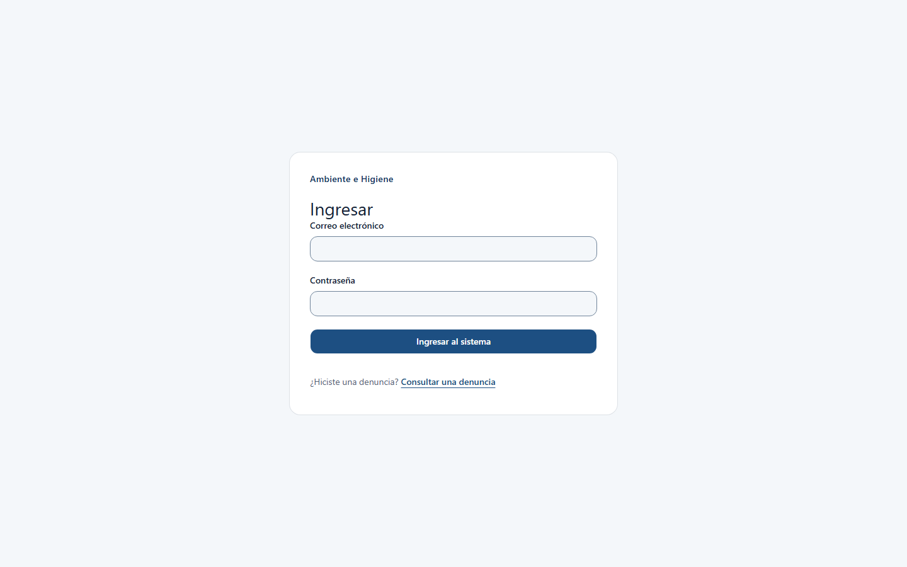

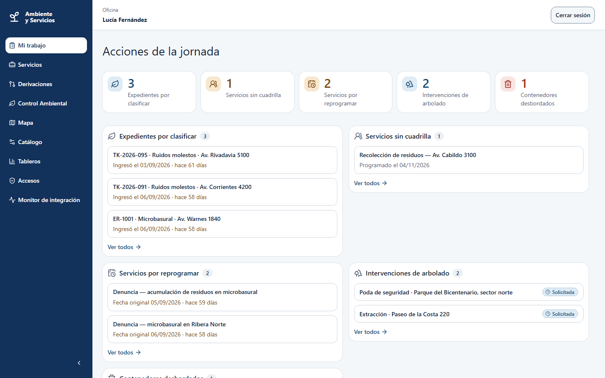

**Si algo falla**

| Mensaje | Qué hacer |
|---|---|
| *El correo o la contraseña no son correctos.* | Revise los datos. El correo se conserva; la contraseña hay que escribirla de nuevo |
| *Esta cuenta no tiene acceso a M6.* | Es una cuenta de vecino, no de empleado. Use una cuenta de empleado |
| *La cuenta no puede iniciar sesión. Contacte al soporte de M1.* | La cuenta está inactiva. Avise al equipo |
| Pantalla **Sin rol asignado** | Su cuenta es válida pero Oficina no le asignó un rol de M6. Pida la asignación y use **Cerrar sesión** |

**Salir:** pulse **Cerrar sesión**, arriba a la derecha.

### Tarea 2 — Programar un servicio (Oficina)

**Dónde:** menú **Servicios**.

1. Entre a **Servicios**: se ven el mapa y la tabla.
2. Pulse **Programar servicio**.
3. Complete el formulario:
   - **Tipo de servicio**: por ejemplo *Barrido mecánico*. El tipo define si el servicio es por recorrido o puntual.
   - **Cuadrilla (opcional)**: puede dejarla en *Sin asignar* y asignarla después (tarea 3).
   - **Recorrido asignado**, si el tipo es por recorrido: las zonas se cargan solas. Si el tipo es puntual, el **Tipo de objetivo** lo define el tipo de servicio (contenedor, árbol, espacio verde o punto verde): busque y elija el **Elemento**, o indique **Zona operativa** y **Dirección o referencia**.
   - **Fecha programada**: hoy o posterior.
   - **Desde** y **Hasta**: la ventana horaria (hora y minutos).
   - En **Más datos** (se despliega): **Origen del servicio** (*Registro manual* o *Planificación*, para trabajo recurrente) y **Notas (opcional)**.
4. Pulse **Programar servicio** en el formulario.

**Resultado esperado:** el servicio aparece en la tabla en estado **Programado**, sin vehículo y, si dejó la cuadrilla en *Sin asignar*, sin cuadrilla.

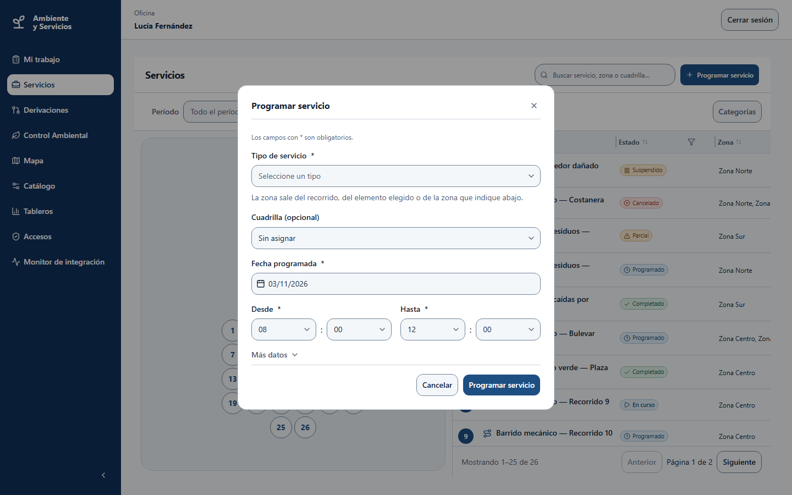

**Notas.** Si se entra desde una denuncia, el formulario muestra *«Origen: Denuncia ciudadana»* y, si hace falta, el campo **Nº de reclamo**: pegue el **UUID técnico** del ticket de M2: el código corto `TK-…` no sirve (*«El ticketId debe ser un UUID válido»*). Una fecha pasada se rechaza (*«La fecha programada debe ser hoy o una fecha posterior en Argentina»*).

### Tarea 3 — Asignar una cuadrilla y un vehículo (Oficina)

**Dónde:** detalle del servicio.

1. Abra el servicio (estado **Programado** o **A reprogramar**) y pulse **Asignar cuadrilla** (si ya tenía una, **Reasignar cuadrilla**).
2. Elija la **Cuadrilla asignada** y, si el tipo de servicio lo exige, el **Vehículo operativo**.
3. Si aparece el aviso **Revise la asignación** (superposición horaria, cuadrilla de otra zona o de otra especialidad), escriba la **Justificación de la asignación** (de 10 a 500 caracteres). Queda registrada con su nombre y la fecha. El sistema avisa pero no bloquea: a veces la misma cuadrilla hace dos tareas seguidas.
4. Pulse **Confirmar asignación**.

**Resultado esperado:** el detalle muestra la cuadrilla y el vehículo asignados; el servicio sigue **Programado**. Ahora el responsable de esa cuadrilla puede iniciarlo.

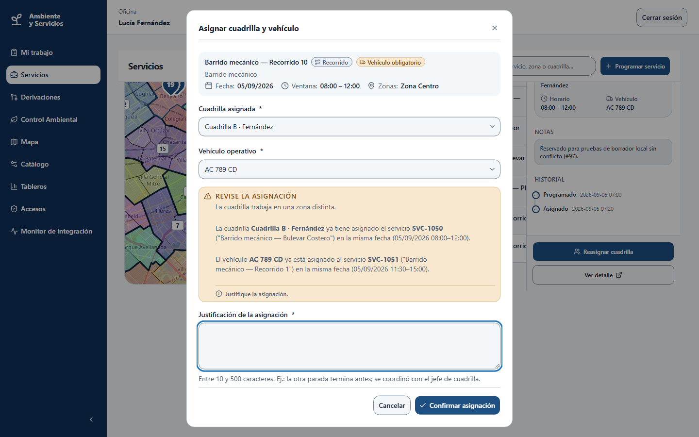

### Tarea 4 — Reprogramar o cancelar un servicio (Oficina)

**Reprogramar** (dos pasos, para que nunca quede una fecha inventada):

1. En un servicio **Programado**, pulse **Reprogramar** y escriba el **Motivo** (obligatorio). El servicio pasa a **A reprogramar**.
2. Cuando conozca la nueva fecha, abra el servicio y pulse **Confirmar nueva fecha**; indique fecha y ventana horaria y confirme.

**Resultado esperado:** vuelve a **Programado** con la fecha nueva y el motivo en el historial.

**Cancelar:**

1. Abra el servicio. Se puede cancelar si está **Programado**, **A reprogramar** o **Suspendido**.
2. Pulse **Cancelar servicio**, escriba el **Motivo** (obligatorio) y pulse **Confirmar cancelación**.

**Resultado esperado:** el servicio queda **Cancelado** y no se puede deshacer. Un servicio **En curso** no se cancela: Campo debe suspenderlo o completarlo primero.

### Tarea 5 — Ejecutar un servicio en la calle (Campo, responsable)

**Dónde:** **Mi trabajo** o **Servicios**.

1. Ingrese con un usuario de Campo (responsable). En **Mi trabajo** figuran los servicios de su cuadrilla.
2. Pulse **Abrir** en el servicio y luego **Iniciar servicio** (el botón también está en la lista). Pasa a **En curso**.
   - No se puede iniciar sin cuadrilla asignada, ni sin vehículo si el tipo lo exige, ni con un corte de calle pendiente.
   - Si lo inicia fuera de la ventana horaria, el sistema lo permite y deja el aviso *«Inicio fuera de ventana horaria»*.
3. Para cada zona elija **Atendida**, **Parcial** o **No atendida** y guarde con **Guardar zona**.
   - Con **Parcial** o **No atendida** hay que elegir el **Motivo de la excepción** y **adjuntar al menos una evidencia** (tarea 6).
4. Cuando todas las zonas tengan resultado, pulse **Completar servicio**. Si falta alguna, la pantalla lo indica con *«Complete la … para finalizar.»*.

**Resultado esperado:** el servicio queda **Completado** si todas las zonas se atendieron, o **Parcial** si alguna no. Lo calcula el sistema; no se elige. Oficina lo ve en **Servicios**.

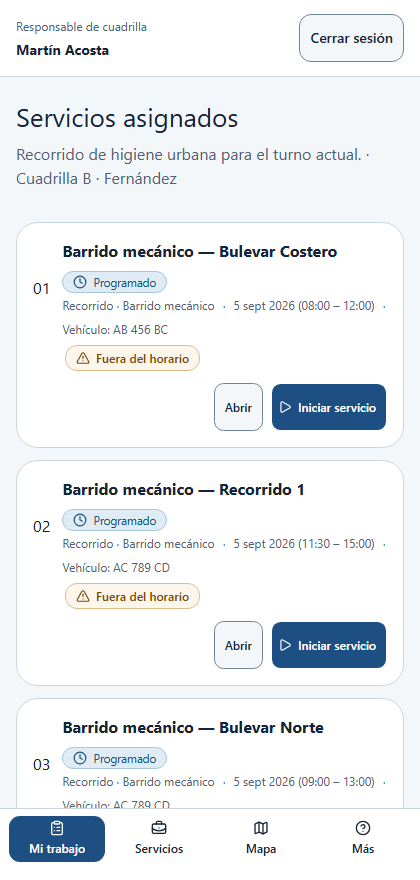
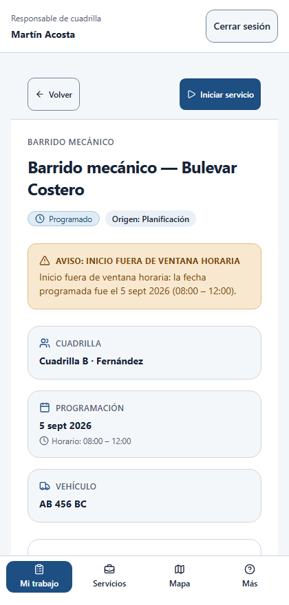

**Suspender y reanudar.** Con el servicio **En curso** y un impedimento, **Suspender servicio** (pide un motivo y, opcionalmente, una nota). Con la causa resuelta, **Reanudar servicio**. Un servicio suspendido que no se puede retomar lo cancela Oficina.

**Si algo falla:** *«Debe adjuntar al menos una evidencia para este resultado»* y *«El motivo es obligatorio para resultados parciales o no atendidos»* indican qué falta en una zona parcial o no atendida.

### Tarea 6 — Adjuntar evidencia (Campo)

**Dónde:** el formulario de la zona o de la inspección.

1. Pulse **Seleccionar archivo(s)** y elija las fotos o el documento.
2. Se aceptan **JPEG, PNG, WebP y PDF, de hasta 4 MB por archivo**. Se suben de a uno.
3. Si uno falla, pulse **Reintentar carga**; use **Quitar** para sacarlo de la lista.

**Resultado esperado:** cada archivo queda asociado a la zona o a la inspección. Las fotos pierden sus metadatos (ubicación y datos de la cámara) al subirse; los PDF se guardan tal cual. Reintentar no duplica el archivo.

### Tarea 7 — Recibir una denuncia ambiental y asignarla (Oficina)

**Dónde:** menú **Control Ambiental**.

1. Abra **Control Ambiental**: la cola de expedientes. Filtre por **Estado**, **Tipo de hallazgo** y **Prioridad**, o busque por ID, dirección o ticket; también puede filtrar por **Última actualización** (Desde y Hasta). El botón **Abrir reporte** carga un expediente nuevo.
2. Abra un expediente en estado **Recibido** y pulse **Iniciar revisión**. Pasa a **En revisión**.
3. En **En revisión**, el recuadro **Acciones** ofrece tres caminos:
   - **Programar inspección**: elija la **zona operativa**, la fecha y la cuadrilla.
   - **Derivar expediente** si no es de nuestra competencia (vuelve a M2).
   - **Desestimar expediente** si se descarta sin inspección.

**Resultado esperado:** con **Programar inspección**, el expediente pasa a **Inspección programada** y se crea el servicio de inspección para la cuadrilla elegida. El sistema avisa si la denuncia podría estar duplicada.

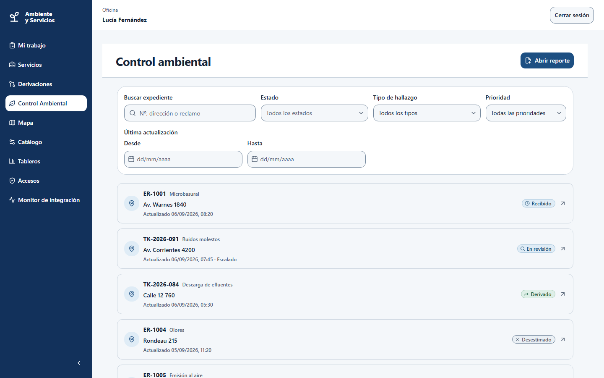
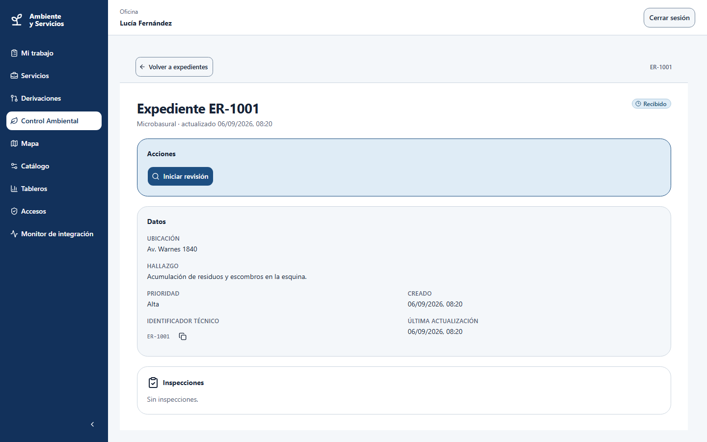

**Si algo falla:** *«Debe seleccionar una zona operativa para programar la inspección»*. Si ve *«No se pudo actualizar el expediente. Recargue la pantalla»*, el expediente cambió de estado: recargue y revise las acciones disponibles.

### Tarea 8 — Registrar la inspección y emitir el acta

**8.A. Completar la inspección (Campo, responsable).**

1. Abra el servicio de inspección y pulse **Iniciar servicio**. Hasta entonces el formulario está bloqueado.
2. Indique la **Fecha y hora de inspección** (se admite una diferencia de 5 minutos por el reloj del dispositivo).
3. Marque cada control del **Checklist asignado** (*«Faltan controles por completar»* mientras falten).
4. Elija el **Resultado de la inspección**: sin infracción, infracción constatada o inconcluso. Con infracción, complete el tipo, la gravedad y la **Acción sugerida**. Con inconcluso, explique qué impidió confirmarlo.
5. Agregue la **Evidencia de la inspección** (tarea 6) y pulse **Completar inspección**.

**Resultado esperado:** el expediente pasa a **Inspeccionado** y luego a **Sin infracción**, **Infracción constatada** o queda para reinspección (si fue inconcluso). Si el servicio sigue abierto, falta registrar el resultado de la zona y completarlo (tarea 5).

**8.B. Emitir el acta (Oficina).**

1. En un expediente con **Infracción constatada**, pulse **Emitir acta**. Para emitirla, la inspección debe tener evidencia (*«Agregue evidencia a la inspección para emitir el acta»*).
2. Verifique la inspección y elija el **establecimiento**. **El acta no se puede modificar**: si hay un error se emite otra.
3. Confirme.

**Resultado esperado:** el expediente pasa a **Acta emitida** y el acta se envía a M4. La acción sugerida (advertencia, intimación, multa o clausura) **no es vinculante**: decide M4. Si no se encuentra el establecimiento, pulse **Continuar sin establecimiento**: la pantalla avisa *«El acta no se enviará a Faltas. El expediente se cierra.»*

Con resultado inconcluso, Oficina usa **Programar reinspección**: se crea una nueva inspección y un nuevo servicio, y la anterior queda en la historia.

### Tarea 9 — Registrar la sanción de M4 y cerrar el expediente (Oficina)

**Dónde:** **Control Ambiental**, detalle del expediente.

1. M4 resuelve el acta y responde por el bus. **La sanción llega sola**: no se carga a mano. El expediente pasa a **Sancionado**.
2. Si el acta queda sin respuesta de M4 pasado el plazo, el expediente se **cierra solo**.
3. En los estados **Derivado**, **Desestimado**, **Sin infracción** y **Sancionado**, pulse **Cerrar expediente**.

**Resultado esperado:** el expediente queda **Cerrado**. Un expediente **Sancionado** no se reabre; si el vecino rechaza la solución en M2, el expediente vuelve a **En revisión** (salvo si fue sancionado). *(La pantalla no tiene una acción para cargar una sanción a mano: no se encontró en el código del frontend.)*

### Tarea 10 — Gestionar un contenedor (Oficina)

**Dónde:** menú **Catálogo** → **Contenedores**. Abra el contenedor con la flecha de su fila (**Ver detalle**); las acciones se ejecutan desde el detalle. Según la tabla de roles del frontend, reportar desborde o daño y vaciar son acciones de Campo (cuadrilla).

| Situación | Acción | Resultado esperado |
|---|---|---|
| Desbordado | **Reportar desborde**, luego **Vaciar contenedor** → **Confirmar vaciado** | Vuelve a **Activo** |
| Roto | **Reportar daño**: elija el **tipo** (estructura, quemado, tapa rota, ruedas rotas, vandalizado o faltante) y la **severidad**, ambos obligatorios | Pasa a **Dañado** |
| Dañado | **Iniciar reparación** → completar la reparación | Pasa por **En reparación** y vuelve a **Activo** |
| Dañado sin arreglo | Confirmar el retiro | **Retirado** |
| Hay que moverlo | Iniciar y confirmar la reubicación (nueva dirección) | Vuelve a **Activo** |

El vaciado y la reubicación se ejecutan como un servicio puntual: **cerrar ese servicio** es lo que cambia el estado del contenedor. El código de un contenedor no se puede cambiar después de crearlo.

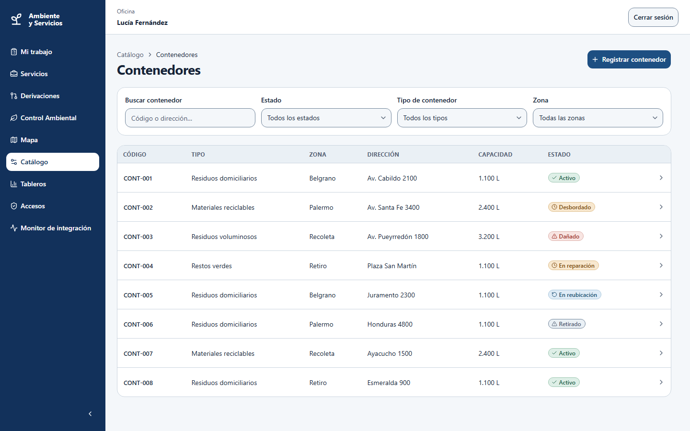

### Tarea 11 — Consultar el estado de una denuncia sin ingresar (vecino)

**Dónde:** `https://m6-ambiente-higiene.vercel.app/consulta` (no pide usuario).

1. Abra la dirección y elija **Seguir mi denuncia** (también hay consultas de **servicios** y de **puntos verdes**).
2. Escriba el **código de su comprobante** (el identificador del reclamo que le dio M2) y pulse **Consultar**.

**Resultado esperado:** se muestra la **etapa** de la denuncia, el tipo, la dirección y las fechas. **No** se muestran el inspector, los hallazgos ni el acta. Si el código no corresponde a ninguna denuncia, se muestra siempre el mismo mensaje, *«No encontramos una denuncia con ese código. Revisá que sea el código de seguimiento de tu comprobante.»*: no se revela si existe. Hay un límite de consultas por minuto: si lo supera, espere un momento *(texto del aviso de límite: verificar en la UI)*.

### Tarea 12 — Trabajar sin conexión (Campo)

1. Si una acción de Campo falla por falta de conexión, el formulario queda como **borrador local** en ese dispositivo, con el aviso *«Sin conexión. Se guardó en este dispositivo; reenvíe cuando vuelva la conexión.»* y la marca **Borrador local pendiente**.
2. Cuando vuelva la señal, pulse **Reenviar**. Nada se envía sin que usted lo confirme.
3. Si el reenvío es rechazado (por ejemplo, porque Oficina cambió el servicio mientras tanto), la pantalla muestra el motivo: revise el estado actual del servicio antes de volver a intentarlo.

**Resultado esperado:** no se pierde nada; el borrador pertenece al usuario que lo escribió.

### Tarea 13 — Leer los indicadores (Oficina)

**Dónde:** menú **Tableros**.

1. Elija **Desde**, **Hasta**, **Familia**, **Zona operativa** y **Tipo de servicio**, y pulse **Actualizar**. También hay atajos de período: **Última semana**, **Último mes** y **Último trimestre**.
2. Cada gráfico puede verse como **Barras** o como **Tabla**.

| Familia | Qué mide |
|---|---|
| Cobertura | Objetivos atendidos sobre programados |
| Cumplimiento | Servicios en fecha y ranking de zonas no atendidas con sus motivos |
| Incidencias | Contenedores desbordados y dañados, árboles por riesgo, tiempo medio de resolución de denuncias |
| Residuos | Kilos y metros cúbicos por tipo y destino; porcentaje desviado del relleno |

**Resultado esperado:** los gráficos reflejan el período y los filtros elegidos. Cada tarjeta compara con el período anterior y con la meta, cuando existe (*Cumple la meta* o *Bajo la meta*). La unidad de análisis es **servicio + zona**: un recorrido que pasa por cuatro zonas y atiende tres cuenta como tres objetivos atendidos y uno pendiente. Los servicios cancelados no cuentan como incumplimiento.

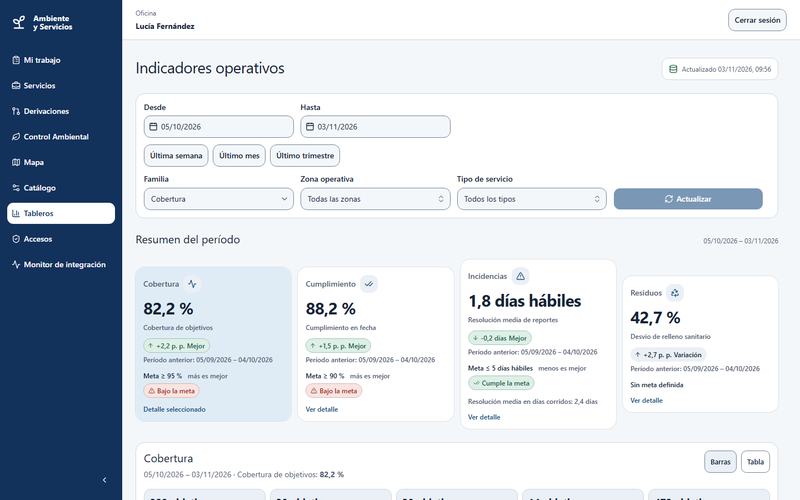

### Tarea 14 — Otras consultas y tareas de Oficina

- **Buscar y filtrar servicios:** en **Servicios**, escriba en la búsqueda o use **Período**, **Categorías** y los filtros de columna; **Limpiar todos los filtros aplicados** vuelve a la lista completa. El mapa y la tabla muestran lo mismo.
- **Pedir un corte de calle o una reparación:** en el detalle de un servicio **Programado** o **A reprogramar**, **Solicitar corte de calle** (a M7; con el corte pendiente el servicio no puede iniciarse) o crear una derivación de reparación (a M3). Las respuestas se siguen en **Derivaciones**.
- **Administrar catálogos:** **Catálogo** reúne tipos de servicio, zonas operativas, recorridos, frecuencias, cuadrillas, vehículos, contenedores, puntos verdes, espacios verdes, arbolado y sitios de disposición. La baja es lógica y el código de un contenedor, un tipo de servicio o un relevamiento no se puede cambiar.
- **Intervenciones sobre arbolado:** en **Catálogo → Arbolado** y **Intervenciones de arbolado**, solicitar la intervención; una extracción exige justificación y autorización de un administrador. Para un relevamiento, abra el árbol y pulse **Registrar relevamiento**.
- **Consultar el mapa:** **Mapa** muestra zonas, cobertura, puntos verdes, espacios verdes y árboles con riesgo crítico, con capas que se activan o desactivan. Toda la información del mapa también está en una lista.
- **Accesos y Monitor de integración:** las entradas **Accesos** (asignar roles de M6) y **Monitor de integración** (eventos salientes fallidos) aparecen solo si su perfil las permite.

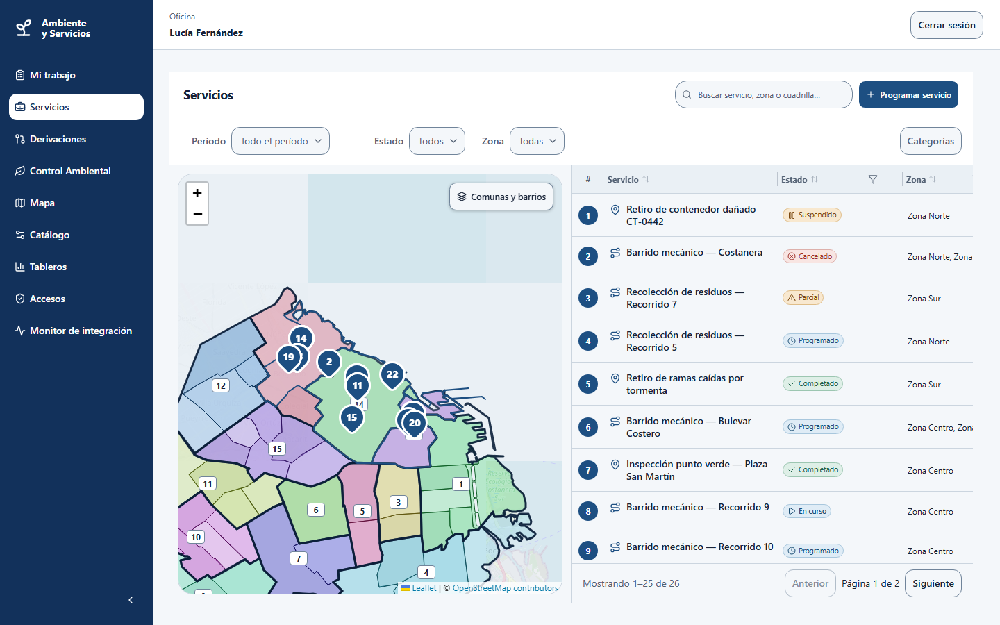
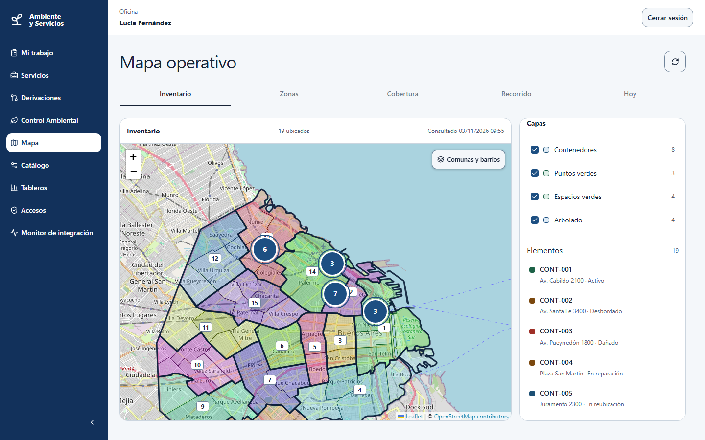

---

## 3. Qué hacer ante errores comunes

| Situación | Qué significa | Qué hacer |
|---|---|---|
| **401**, *«Inicie sesión para continuar»* | La sesión venció o no existe | Pulse **Volver a iniciar sesión** (la pantalla de ingreso lo lleva de vuelta a donde estaba) |
| **403** | Su perfil no puede hacer eso (**ROLE_REQUIRED**), o el servicio o la inspección es de otra cuadrilla (**NOT_ASSIGNED**) | No es un error del sistema: pida a Oficina que lo haga o que lo reasigne. Un botón que falta responde a la misma regla |
| **409** | El paso no corresponde al estado actual (por ejemplo, completar un servicio que ya se completó, o iniciarlo con un corte pendiente); suele pasar si otra persona cambió el registro | Recargue la pantalla y revise qué acciones ofrece ahora |
| **Sesión expirada en medio de una tarea** | La sesión venció mientras trabajaba | Vuelva a ingresar. Lo que haya quedado como borrador local (Campo) se conserva |
| **El backend tarda o no responde** (Render dormido) | Primer uso del día | Espere unos 30 segundos, pulse **Reintentar carga** o recargue. Al ingresar, el aviso indica que puede tardar hasta un minuto y medio |
| *No se pudo cargar el escenario* | Falló la carga inicial | Pulse **Reintentar carga**; si persiste, avise al equipo |
| *No se pudo subir el archivo* | Falló la subida | Pulse **Reintentar carga** y verifique que sea JPEG, PNG, WebP o PDF de hasta 4 MB |
| *Hay un solapamiento: justifique la asignación en al menos 10 caracteres* | La cuadrilla o el vehículo ya están ocupados | Escriba una justificación de 10 a 500 caracteres o elija otra cuadrilla |
| *Conflicto de sincronización* | El servicio cambió mientras trabajaba sin conexión | Compare las versiones y decida si conserva o descarta el borrador |
| *No se pudieron cargar las derivaciones de este Servicio* | Falló la consulta | Cierre y vuelva a abrir el servicio |

Soporte: abra un Issue en el repositorio ([Frontend](https://github.com/hllous/Frontend-M6-DAPS2) o [Backend](https://github.com/hllous/Backend-M6-DAPS2)) con una captura y los pasos para reproducirlo.

---

## 4. Referencia rápida de estados

### 4.1 Servicio

| Estado | Qué puede hacer cada rol |
|---|---|
| **Programado** | Oficina: asignar, reprogramar, cancelar. Responsable de cuadrilla: iniciar |
| **A reprogramar** | Oficina: confirmar nueva fecha, asignar, cancelar |
| **En curso** | Responsable: registrar zonas, suspender, completar |
| **Suspendido** | Responsable: reanudar. Oficina: cancelar |
| **Completado**, **Parcial**, **Cancelado** | Estados finales |

«Demorado» **no es un estado**: un servicio demorado sigue **Programado** o **En curso**. Un servicio puede pasar a **A reprogramar** solo, cuando M7 rechaza un corte de calle o entra una alerta meteorológica.

### 4.2 Expediente ambiental

Recibido → En revisión → (Inspección programada → Inspeccionado → Sin infracción | Infracción constatada | reinspección) → Acta emitida → Sancionado → Cerrado. Desde **En revisión** también se puede pasar a **Derivado** o **Desestimado**.

### 4.3 Contenedor

Activo, Desbordado, Dañado, En reparación, En reubicación, Retirado.

### 4.4 Resultado de una zona

| Resultado | Pide motivo | Pide evidencia |
|---|---|---|
| Atendida | No | Opcional |
| Parcial | Sí | Sí |
| No atendida | Sí | Sí |

### 4.5 Qué ve cada perfil

| Función | Oficina | Campo responsable | Campo integrante |
|---|---|---|---|
| Ver servicios, mapa y expedientes | ✔ | ✔ | ✔ |
| Programar, asignar, reprogramar, cancelar | ✔ | — | — |
| Iniciar, suspender, completar servicios | — | ✔ (su cuadrilla) | — |
| Completar inspecciones | — | ✔ (si es el inspector asignado) | — |
| Administrar catálogos, clasificar denuncias, emitir actas | ✔ | — | — |
| Ver indicadores | ✔ | — | — |

Estas reglas **se aplican en el servidor** además de en la pantalla: una acción no permitida recibe 403 aunque se intente por otro medio.

---

## 5. Limitaciones conocidas

- **Catálogo de barrios:** la lista usada para armar zonas es provisoria hasta conectar el catálogo de M9.
- **Establecimientos:** la búsqueda al emitir un acta usa una lista local hasta que M4 publique la suya.
- **Aviso de demora:** el servidor lo soporta, pero la pantalla todavía no lo ofrece.
- **Exportación:** no hay exportación de registros a archivo; los indicadores son de lectura en pantalla.
- **PDF adjuntos:** no se limpian de metadatos ni se analizan en busca de virus.
- **Campo y el catálogo:** reportar contenedores y registrar relevamientos están permitidos para Campo, pero el menú lateral de Campo incluye **Catálogo**, porque cualquier rol de M6 puede consultarlo.
- **Capturas:** son del 03/11/2026, sacadas con Playwright en modo mock sobre la rama `develop` del frontend (datos de prueba, no reales).

---

## 6. Trazabilidad: tarea del manual → historia de usuario

Las HU son las del tablero «M6 - Product Backlog & Story Map» de Trello; sus identificadores `HU-01` a `HU-33` y sus criterios están en `02-historias-y-criterios.md`. La columna «Historia de usuario» cita el título en Trello; la tabla ya está conciliada con esos identificadores.

| Tarea del manual | Historia de usuario |
|---|---|
| 1 Ingresar y reconocer su rol | HU-29, HU-30: Como Oficina y como Campo quiero ver y hacer solo lo que mi rol permite, con el rol que viene de M1; Activar la autenticación real de M1 con sesión sellada en el BFF |
| 2 Programar un servicio | HU-05: Como Oficina quiero programar un servicio sobre un recorrido o un punto, con fecha, franja y cuadrilla |
| 3 Asignar cuadrilla y vehículo | HU-05, HU-03: Como Oficina quiero programar un servicio sobre un recorrido o un punto…; Como Oficina quiero administrar tipos de servicio, frecuencias, cuadrillas, vehículos y sitios de disposición |
| 4 Reprogramar o cancelar | HU-06, HU-04: Como Oficina quiero reprogramar o cancelar un servicio con motivo; Como Oficina quiero que al suspender un servicio el motivo y la nota se guarden por separado |
| 5 Ejecutar un servicio | HU-07: Como líder de cuadrilla quiero iniciar el servicio, registrar el resultado de cada zona y cerrarlo |
| 6 Adjuntar evidencia | HU-08: Como miembro de cuadrilla quiero adjuntar fotos como evidencia, con reintento seguro |
| 7 Recibir y asignar una denuncia | HU-15, HU-14: Como Oficina quiero recibir denuncias ambientales y asignarlas a una cuadrilla para inspeccionarlas; Como Oficina quiero filtrar la cola de denuncias por rango de fechas |
| 8 Inspección y acta | HU-16: Como inspector quiero registrar la inspección y emitir el acta de constatación |
| 9 Sanción de M4 y cierre | HU-17: Como Oficina quiero registrar la sanción que devuelve M4 y cerrar el expediente |
| 10 Gestionar un contenedor | HU-11: Como Oficina quiero gestionar contenedores (desborde, daño, vaciado, reparación y reubicación) |
| 11 Consulta del vecino sin ingresar | HU-27: Como vecino quiero consultar sin login el estado de mi denuncia, cuándo pasa el servicio y dónde están los puntos verdes |
| 12 Trabajar sin conexión | HU-08: Como miembro de cuadrilla quiero adjuntar fotos como evidencia, con reintento seguro |
| 13 Leer los indicadores | HU-28: Como Oficina quiero un tablero de indicadores (cobertura, cumplimiento, incidencias y residuos) |
| 14 Otras tareas de Oficina | HU-12, HU-13, HU-09: Como Oficina quiero llevar el censo de arbolado…; Como Oficina quiero administrar espacios verdes y puntos verdes; Como cuadrilla quiero derivar una reparación o pedir un corte de calle |
