# Manual de usuario — Módulo 6: Ambiente e Higiene

> Versión 2.3 · 16/11/2026

> Organizado **por tareas**: cada tarea se puede hacer siguiendo solo su sección. Las capturas de `img/` son del entorno de demostración, con datos ficticios y sin contraseñas. Por eso la pantalla de ingreso de la captura muestra un selector de **Perfil** en lugar del correo y la contraseña, y las pantallas del vecino muestran un aviso de demostración que en la aplicación publicada no aparece.

| | |
|---|---|
| **Producto** | Aplicación web de Ambiente y Servicios, Módulo 6 (Grupo 04), Municipalidad UADE |
| **Público** | Personal municipal de **Oficina** y de **Campo** (responsable e integrante de cuadrilla); el vecino consulta sin ingresar |
| **Idioma** | Español |

---

## 1. Antes de empezar

### 1.1 Qué necesita

- Un navegador actualizado (Chrome, Edge, Firefox o Safari) en computadora, tableta o celular.
- Conexión a internet. La aplicación funciona **en línea**; ante un corte, los formularios de Campo guardan un borrador local (tarea 12).
- La dirección de la aplicación: **`https://m6-ambiente-higiene.vercel.app`**.
- Un usuario y una contraseña de empleado de M1 (Identidad). **Las credenciales de prueba las entrega el equipo por fuera de este manual**; no se publican acá.

### 1.2 Si el sistema tarda en responder

El servidor del backend y el de identidad se «duermen» cuando no se usan. La **primera** operación del día puede tardar:

- Al ingresar, aparece el aviso *«El servicio de ingreso está iniciando, puede tardar hasta un minuto y medio.»* No cierre la pantalla ni pulse dos veces: espere.
- Si pasado ese tiempo aparece *«El servicio de ingreso no respondió dentro de un minuto y medio. Intente nuevamente.»*, el servicio de identidad todavía estaba despertando: vuelva a escribir la **Contraseña** (el campo se vacía) y pulse **Ingresar al sistema** otra vez. El segundo intento suele entrar en segundos.
- Si el resto de la aplicación muestra **No se pudo cargar la pantalla** justo después de abrirla, **espere unos 30 segundos** y pulse **Reintentar carga** (o recargue la página).
- `https://m6-ambiente-higiene.vercel.app/api/health` responde `"status":"ok"` cuando la aplicación web está publicada. No comprueba el backend ni el servicio de identidad: esos pueden seguir dormidos aunque la respuesta sea `ok`.

### 1.3 Los dos tipos de usuario

| Rol | Qué hace | Dónde trabaja |
|---|---|---|
| **Oficina** (Operaciones, Ambiental y administración) | Programa servicios, asigna cuadrillas y vehículos, reprograma o cancela, administra los catálogos, clasifica denuncias, autoriza intervenciones sobre árboles y emite actas. Qué parte de eso puede hacer cada cuenta está en 1.4 | Escritorio, con tablas y mapa |
| **Campo — responsable de cuadrilla** | Inicia, suspende y completa los servicios de su cuadrilla; registra el resultado de cada zona; adjunta evidencia; reporta daño y desborde y vacía contenedores | Celular o tableta |
| **Campo — inspector** | Completa las inspecciones ambientales que se le asignaron | Celular o tableta |
| **Campo — integrante de cuadrilla** | Consulta el trabajo asignado de su cuadrilla, el mapa y los expedientes. En el detalle de un servicio la pantalla muestra **Solo consulta** y **no ofrece** Iniciar servicio ni los demás botones del responsable | Celular o tableta |
| **Auditoría** | Solo lectura: ve servicios, expedientes, mapa y tableros, sin botones para modificar | Escritorio |

En la parte superior de la pantalla, junto a **Cerrar sesión**, figura su perfil y debajo su nombre. El rótulo puede repetirse entre cuentas con permisos distintos: las de Operaciones, Ambiental, auditoría y administración muestran todas **Oficina**; el responsable de cuadrilla muestra **Responsable de cuadrilla**, y el integrante, **Integrante de cuadrilla**. El inspector de la demostración es responsable de la cuadrilla de inspección, así que también muestra **Responsable de cuadrilla**.

**Cómo abrir un servicio.** En **Servicios** (Oficina), pulse la fila del servicio y luego **Ver detalle**; desde **Mi trabajo**, pulse el nombre del servicio. En **Mi trabajo** de Campo, pulse **Abrir**. Para salir del detalle, Oficina pulsa **Volver a Servicios** y Campo, **Volver**. Todas las tareas de este manual dicen «abra el servicio» y significan eso.

Una persona no es Oficina y Campo a la vez. Cada usuario ve solo las entradas de menú que su perfil permite; un botón que falta casi siempre significa que ese paso no corresponde al estado o al perfil (ver sección 4).

### 1.4 Qué cuenta usar en cada tarea

El perfil de cada cuenta decide qué botones ve (sección 4.5). Para repetir las tareas de este manual, ingrese con la cuenta indicada; con otra, es normal que falten botones. La contraseña la entrega el equipo por fuera del manual.

| Tarea | Cuenta | Perfil |
|---|---|---|
| 1 (ingresar), 13 (tableros) | cualquiera de las cuentas de la tabla | — |
| 2, 3, 4 (programar, asignar, reprogramar o cancelar servicios) | `julian.lopez.10002@municipio.gob.ar` | Oficina de Operaciones |
| 5 (ejecutar servicios), 6 (evidencia), 12 (sin conexión) | `sofia.lopez.10009@municipio.gob.ar` | Campo, responsable de cuadrilla |
| 7 (denuncia ambiental), 8.B (emitir el acta), 9 (cerrar el expediente) | `diego.sosa.10004@municipio.gob.ar` | Oficina Ambiental |
| 8.A (hacer la inspección en la calle) | `carlos.medina.10011@municipio.gob.ar` | Campo, inspector |
| 10 (reportar desborde, reportar daño, vaciar contenedor) | `sofia.lopez.10009@municipio.gob.ar` | Campo, responsable de cuadrilla |
| 10 (iniciar y completar reparación, reubicar, confirmar ubicación, retirar contenedor) | `julian.lopez.10002@municipio.gob.ar` (o la de administración) | Oficina de Operaciones |
| 14 (consultas, contenedores, puntos y espacios verdes, árboles, derivaciones, cortes de calle) | `julian.lopez.10002@municipio.gob.ar` | Oficina de Operaciones |
| 14 (autorizar o rechazar la extracción de un árbol; tipos de servicio, recorridos, frecuencias, cuadrillas, vehículos, zonas y sitios de disposición; **Accesos**; **Eventos**, que también ve la cuenta de auditoría `camila.medina.10007@municipio.gob.ar`) | `carlos.rodriguez.10000@municipio.gob.ar` | Administración |
| Ver cómo se limita el integrante de cuadrilla | `diego.martinez.10010@municipio.gob.ar` | Campo, integrante |
| Solo lectura | `camila.medina.10007@municipio.gob.ar` | Auditoría |
| 11 (consulta del vecino) | ninguna: es pública | — |

Oficina de Operaciones **no** ve las acciones de clasificación de las denuncias ambientales (**Iniciar revisión**, **Derivar expediente**, **Desestimar expediente**, **Pedir información al vecino**, **Programar inspección**, **Cerrar expediente**): son de Oficina Ambiental y de administración. Sí ve, en un expediente con **Inspección programada**, **Reprogramar inspección**, porque reprograma el servicio de la inspección. Oficina Ambiental no ve las acciones de servicios ni de contenedores.

---

## 2. Tareas

Cada tarea indica **Quién**, **Dónde**, los **Pasos** y el **Resultado esperado**.

### Tarea 1 — Ingresar y reconocer su rol

**Quién:** todos los empleados. **Dónde:** pantalla de ingreso.

1. Abra `https://m6-ambiente-higiene.vercel.app`. Si no tiene sesión, se muestra la pantalla **Ingresar** (*«Ingrese con su usuario y contraseña municipal.»*).
2. Escriba su **Correo electrónico** (el de empleado, con la forma `nombre.apellido.NNNNN@municipio.gob.ar`) y su **Contraseña** (el ícono del ojo la muestra u oculta).
3. Pulse **Ingresar al sistema**. Mientras valida, el botón muestra *«Ingresando…»* y los campos se bloquean; la primera vez del día puede tardar (sección 1.2).
4. Se abre **Mi trabajo**. El menú de la izquierda muestra las secciones de su perfil: **Mi trabajo**, **Servicios**, **Derivaciones**, **Control Ambiental**, **Mapa**, **Catálogo** y **Tableros**. La cuenta de administración suma **Accesos** y **Eventos**; la de auditoría suma **Eventos**.

**Resultado esperado:** entra a **Mi trabajo** y, arriba, ve su perfil (**Oficina**, **Responsable de cuadrilla** o **Integrante de cuadrilla**) y, debajo, su nombre. Oficina ve **Acciones de la jornada**: una fila de contadores, uno por grupo de pendientes según la cuenta (Operaciones: **Servicios sin cuadrilla**, **Servicios por reprogramar**, **Intervenciones de arbolado**, **Contenedores desbordados**; Ambiental: **Expedientes por clasificar**), y debajo una tarjeta por grupo con hasta cinco pendientes y el enlace **Ver todos**. Un grupo sin pendientes muestra su contador en 0 pero no su tarjeta; si todos están en 0, aparece *«No tenés tareas pendientes»*. Auditoría ve *«Su perfil es de solo lectura: no tiene tareas para resolver acá.»* con un enlace **Ir a Tableros**. Campo ve **Servicios asignados**: la cantidad (*«N servicios asignados»*) y la lista de servicios de su cuadrilla.

La captura de la pantalla de ingreso es del entorno de demostración, que reemplaza el correo y la contraseña por un selector de **Perfil**; en la aplicación publicada se ven los campos de los pasos 2 y 3.

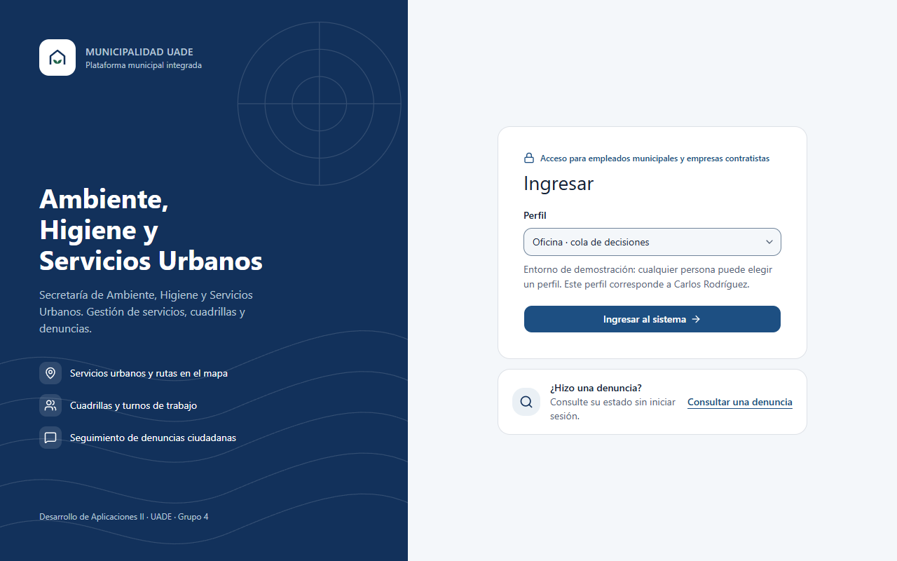

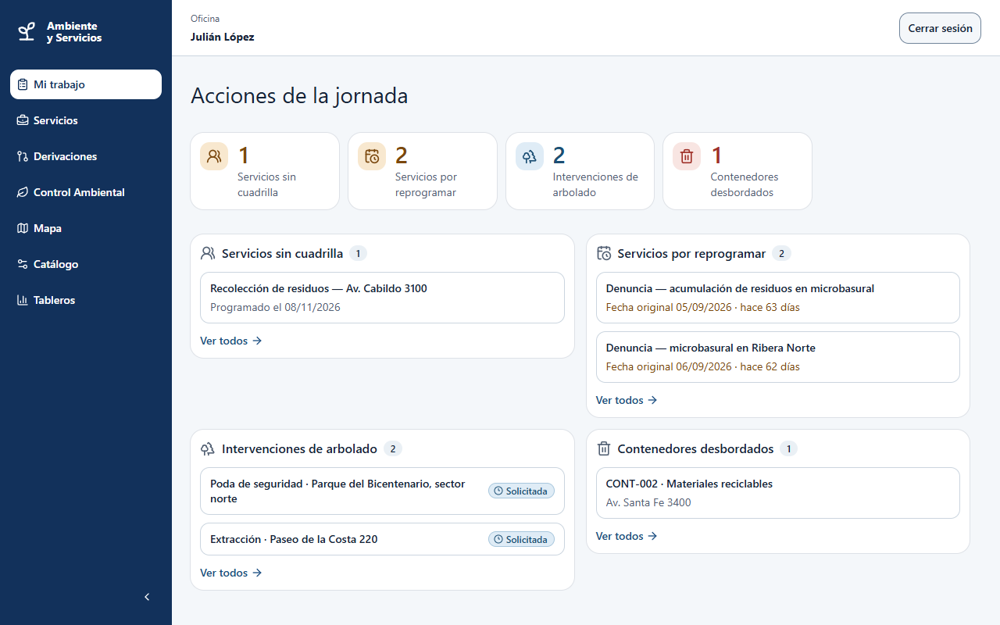

**Si algo falla** (con cualquier error, el campo **Contraseña** se vacía: escríbala de nuevo)

| Mensaje | Qué hacer |
|---|---|
| *El correo o la contraseña no son correctos.* | Revise los datos y escriba la contraseña de nuevo |
| **Sin acceso** · *Esta cuenta no tiene acceso a Ambiente e Higiene.* | Es una cuenta de vecino, no de empleado. Use una cuenta de empleado |
| **Sin acceso** · *La cuenta no puede iniciar sesión. Comuníquese con el administrador del sistema.* | La cuenta está inactiva o bloqueada en M1. Avise al equipo |
| *El servicio de ingreso no respondió dentro de un minuto y medio. Intente nuevamente.* | Identidad estaba dormido. Vuelva a escribir la contraseña e ingrese de nuevo |
| *Demasiados intentos de ingreso fallidos. Intente nuevamente más tarde.* | Hubo varios intentos con datos incorrectos. Espere antes de volver a intentar |
| Pantalla **Sin rol asignado** (*«Su usuario aún no tiene un rol asignado en Ambiente. Solicite a un administrador que se lo asigne y vuelva a ingresar.»*) | Su cuenta es válida pero no tiene un rol de M6. Pida la asignación y use **Cerrar sesión** |

**Salir:** pulse **Cerrar sesión**, arriba a la derecha.

### Tarea 2 — Programar un servicio (Oficina de Operaciones)

**Dónde:** menú **Servicios**.

1. Entre a **Servicios**: se ven el mapa y la tabla (la tabla pagina de a 25; el paginador muestra «Mostrando 1–25 de N» y, si hay más de una página, los botones ‹ › con «1 / N»).
2. Pulse **Programar servicio** (arriba a la derecha). Se abre una ventana con ese título.
3. Complete el formulario (*«Los campos con \* son obligatorios.»*):
   - **Tipo de servicio**: por ejemplo *Barrido mecánico (Recorrido)*. La lista indica entre paréntesis si el tipo es por *Recorrido* o por *Punto* (puntual).
   - **Cuadrilla (opcional)**: puede dejarla en *Sin asignar* y asignarla después (tarea 3). Si la cuadrilla elegida trabaja en otra zona, tiene otra especialidad o ya está ocupada, el formulario pide **Justificación de la asignación** (mínimo 10 caracteres).
   - Si el tipo es por recorrido, aparece **Recorrido asignado**, con un recorrido ya propuesto; confirme que sea el que quiere (las **Zonas** se muestran debajo).
   - Si el tipo es puntual (por ejemplo *Vaciado de contenedor (Punto)*), aparecen **Tipo de objetivo** (bloqueado: *«Lo define el tipo de servicio elegido.»*), el buscador (**Buscar contenedor**, **Buscar árbol urbano**, **Buscar espacio verde** o **Buscar punto verde**) y **Elemento**, donde elige el objetivo. Si el objetivo es *Otra ubicación*, en lugar del buscador aparecen **Zona operativa** y **Dirección o referencia**.
   - **Fecha programada**: hoy o posterior (viene con la fecha de hoy y el calendario no deja elegir días pasados).
   - **Desde** y **Hasta**: la ventana horaria (hora y minutos; vienen con 08:00 y 12:00).
   - En **Más datos** (se despliega): **Origen del servicio** (*Manual* o *Planificado*, para trabajo recurrente) y **Notas (opcional)**.
4. Pulse **Programar servicio** al pie de la ventana (**Cancelar** la cierra sin guardar).

**Resultado esperado:** el servicio aparece en la tabla en estado **Programado**, sin vehículo y, si dejó la cuadrilla en *Sin asignar*, sin cuadrilla. En el detalle, el origen se muestra como *Origen: Registro manual* o *Origen: Planificación*.

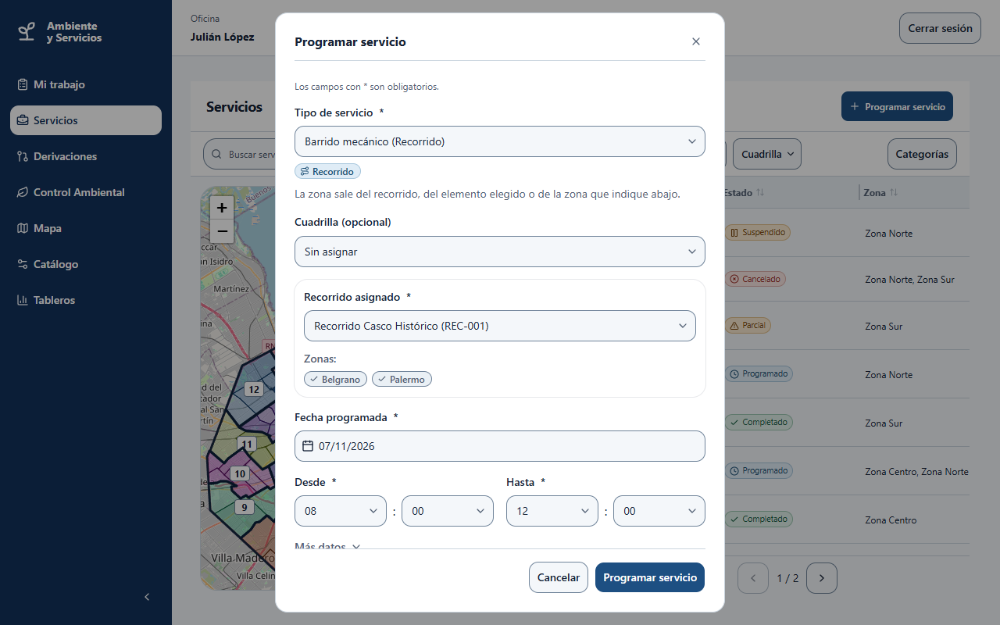

### Tarea 3 — Asignar una cuadrilla y un vehículo (Oficina de Operaciones)

**Dónde:** detalle del servicio.

1. Abra el servicio (estado **Programado** o **A reprogramar**) y pulse **Asignar cuadrilla** (si ya tenía una, **Reasignar cuadrilla**). Atajo: en **Mi trabajo → Servicios sin cuadrilla** figuran los servicios **Programados de hoy a 7 días** que no tienen cuadrilla; al pulsar el nombre se abre directamente la ventana de asignación. Se abre **Asignar cuadrilla y vehículo**, que resume el servicio y marca *Vehículo obligatorio* o *Vehículo opcional* según el tipo.
2. Elija la **Cuadrilla asignada** y el **Vehículo operativo** (obligatorio, con \*, si el tipo lo exige; si no, figura *(opcional)*). La lista de vehículos ofrece las patentes y *Sin vehículo asignado*.
3. Si aparece el recuadro **Revise la asignación** (por ejemplo *«La cuadrilla trabaja en una zona distinta.»*, *«La cuadrilla tiene una especialidad distinta.»* o el aviso de que la cuadrilla o el vehículo ya tienen otro servicio en la misma fecha), escriba la **Justificación de la asignación** (*«Entre 10 y 500 caracteres.»*). Queda registrada con su nombre y la fecha. El sistema avisa pero no bloquea: a veces la misma cuadrilla hace dos tareas seguidas.
4. Pulse **Confirmar asignación**.

**Resultado esperado:** el detalle muestra la cuadrilla y el vehículo asignados; el servicio sigue **Programado**. Ahora el responsable de esa cuadrilla puede iniciarlo.

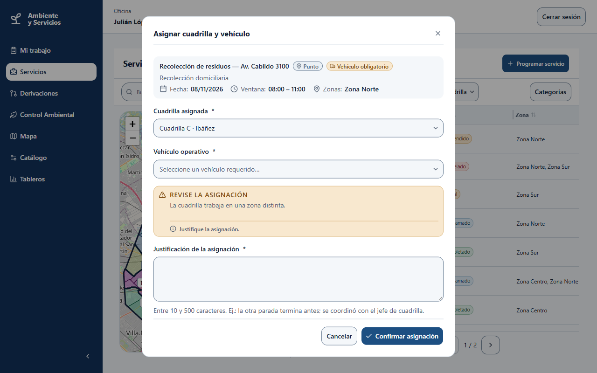

### Tarea 4 — Reprogramar o cancelar un servicio (Oficina de Operaciones)

**Reprogramar un servicio Programado:**

1. Abra un servicio **Programado**: el detalle ofrece **Asignar cuadrilla** o **Reasignar cuadrilla**, **Crear derivación de reparación**, **Reprogramar**, **Cancelar servicio** y **Solicitar corte de calle**.
2. Pulse **Reprogramar**. Se abre la ventana **Reprogramar {nombre del servicio}** con **Motivo**, **Nueva fecha**, **Desde** y **Hasta**, todos obligatorios (la ventana horaria viene con la del servicio).
3. Pulse **Reprogramar**.

**Resultado esperado:** el servicio queda **Programado** con la fecha y la ventana nuevas, y el motivo en el historial.

**Confirmar la fecha de un servicio A reprogramar.** Un servicio pasa solo a **A reprogramar** cuando M7 rechaza un corte de calle o entra una alerta meteorológica; esos servicios están en **Mi trabajo → Servicios por reprogramar**. Ábralo: el detalle muestra el **Motivo** y los botones **Reasignar cuadrilla**, **Crear derivación de reparación**, **Confirmar nueva fecha**, **Cancelar servicio** y **Solicitar corte de calle**. Pulse **Confirmar nueva fecha**, indique **Nueva fecha**, **Desde** y **Hasta**, y pulse **Confirmar nueva fecha**. El servicio vuelve a **Programado**.

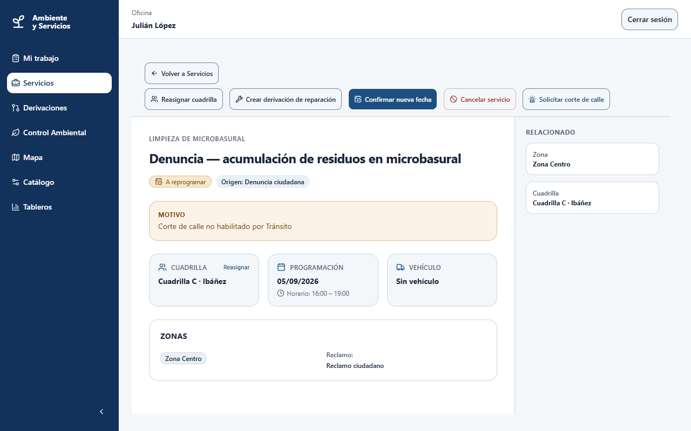

**Cancelar:**

1. Abra el servicio. Se puede cancelar si está **Programado**, **A reprogramar** o **Suspendido**.
2. Pulse **Cancelar servicio**. En la ventana **Cancelar {nombre del servicio}**, escriba el **Motivo** (obligatorio; *«Esta acción no se puede deshacer.»*) y pulse **Confirmar cancelación**.

**Resultado esperado:** el servicio queda **Cancelado** y no se puede deshacer. Un servicio **En curso** no se cancela: Campo debe suspenderlo o completarlo primero.

### Tarea 5 — Ejecutar un servicio en la calle (Campo, responsable)

**Dónde:** **Mi trabajo** o **Servicios**.

1. Ingrese con un usuario de Campo **responsable de cuadrilla**. En **Mi trabajo** figuran los servicios de su cuadrilla. *(Un integrante de cuadrilla abre el mismo servicio, pero ve **Solo consulta** y no se le ofrece Iniciar servicio.)*
2. Pulse **Abrir** en el servicio y luego **Iniciar servicio** (arriba a la derecha; el botón también está en la lista de **Mi trabajo**). Pasa a **En curso**. En la lista, un servicio fuera de su franja muestra la marca *Fuera del horario*.
   - No se puede iniciar sin cuadrilla asignada, ni sin vehículo si el tipo lo exige, ni con un corte de calle pendiente.
   - Si lo inicia fuera de la ventana horaria, el detalle muestra el aviso **Aviso: Inicio fuera de ventana horaria** (por ejemplo *«Inicio fuera de ventana horaria: el servicio está programado para …»*). Al pulsar **Iniciar servicio** se abre **Iniciar servicio fuera de horario**: pulse **Iniciar igual** para confirmar.
3. Para cada zona elija **Atendida**, **Parcial** o **No atendida** y guarde con **Guardar zona**.
   - Con **Parcial** o **No atendida** hay que elegir el **Motivo** (selector «Seleccione un motivo») y **adjuntar al menos una evidencia** (tarea 6). El campo **Detalle (opcional)** admite una nota.
4. Cuando todas las zonas tengan resultado, pulse **Completar servicio**. Mientras falten zonas, el botón está deshabilitado y debajo se lee *«Pendiente: N de M zona(s)»*. Si falta un dato para cerrar (por ejemplo, las coordenadas de un contenedor reubicado), la pantalla lo indica con *«Complete la … para finalizar.»*.

**Resultado esperado:** el servicio queda **Completado** si todas las zonas se atendieron, o **Parcial** si alguna no. Lo calcula el sistema; no se elige. Oficina lo ve en **Servicios**.

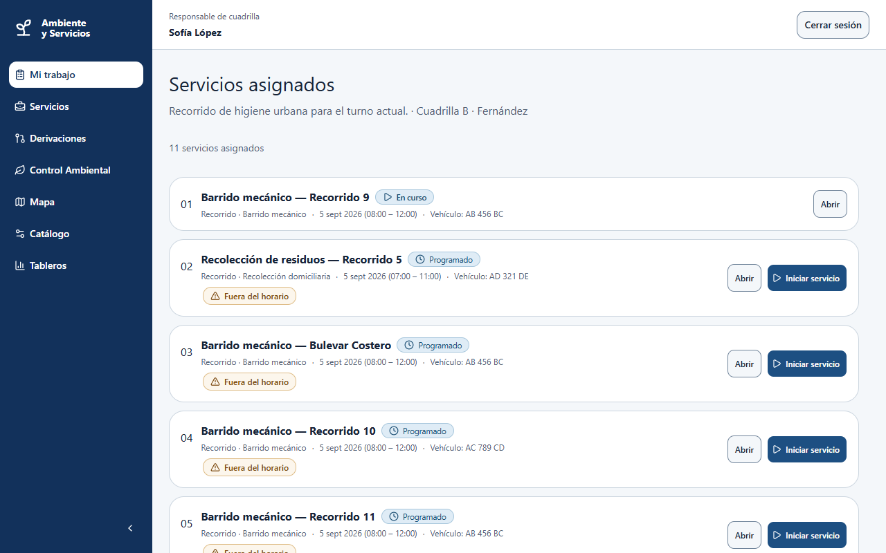

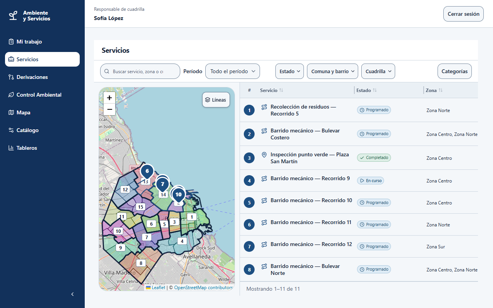

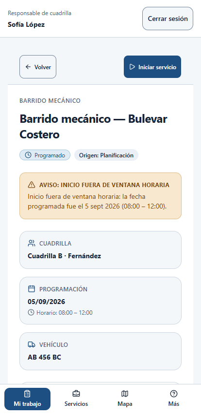

**Suspender y reanudar.** Con el servicio **En curso** y un impedimento, pulse **Suspender servicio**. La ventana pide **Motivo de suspensión** y **Nota**, los dos obligatorios, y admite **Evidencia adjunta** (opcional). Confirme con **Suspender servicio**. Con la causa resuelta, **Reanudar servicio**. Un servicio suspendido que no se puede retomar lo cancela Oficina.

**Si algo falla:** en una zona parcial o no atendida, *«Indique el motivo.»* pide el motivo y *«Adjunte una foto o un acta.»* pide la evidencia. Al suspender, *«Seleccione un motivo.»* y *«Describa la suspensión.»* indican qué falta.

### Tarea 6 — Adjuntar evidencia (Campo)

**Dónde:** el formulario de la zona o de la inspección.

1. En la zona, pulse **Seleccionar archivo**; en la inspección, **Seleccionar archivos**. Elija las fotos o el documento.
2. Se aceptan **JPEG, PNG, WebP y PDF, de hasta 4 MB por archivo**, y se suben de a uno. Un archivo de más de 4 MB se rechaza: en la inspección, al elegirlo (*«"archivo" pesa más de 4 MB.»*); en la zona, al subirlo (*«El archivo supera el tamaño máximo permitido de 4 MB.»*).
3. Cada archivo muestra su estado: *Pendiente*, *Subiendo…* o *Subido*. Si uno falla, pulse **Reintentar** (en la zona) o **Reintentar carga** (en la inspección). Para sacarlo de la lista, use el botón **X** junto al archivo.

**Resultado esperado:** cada archivo queda asociado a la zona o a la inspección. Las fotos pierden sus metadatos (ubicación y datos de la cámara) al subirse; los PDF se guardan tal cual. Reintentar no duplica el archivo.

### Tarea 7 — Recibir una denuncia ambiental y asignarla (Oficina Ambiental)

**Dónde:** menú **Control Ambiental**.

1. Abra **Control Ambiental**: la pantalla **Control ambiental** muestra la cola de expedientes. Cada fila muestra el número del expediente (`EXP-AAAA-NNNNNN`, o `TK-…` si viene de un reclamo; sin número, el tipo de hallazgo y la dirección), el tipo de hallazgo, la dirección, la última actualización y el estado. Busque con **Buscar expediente** (*«Nº, dirección o reclamo»*), filtre por **Estado**, **Tipo de hallazgo** y **Prioridad**, o por **Última actualización** (**Desde** y **Hasta**; **Limpiar fechas** las borra).
2. Pulse la fila de un expediente en estado **Recibido**. En el detalle, pulse **Iniciar revisión** y confirme con **Iniciar revisión** en la ventana que se abre (si el expediente tiene un reclamo vinculado, la ventana avisa que el vecino verá el cambio). Pasa a **En revisión**.
3. En **En revisión**, el recuadro **Acciones** ofrece:
   - **Programar inspección**: se abre una ventana con **Fecha de inspección**, **Inicio** y **Fin**, **Zona operativa** y **Cuadrilla** (la fecha, la zona y la cuadrilla son obligatorias; si la cuadrilla no encaja, también **Justificación**); confirme con **Programar inspección**.
   - **Derivar expediente** si no es de nuestra competencia (vuelve a M2): la ventana pide el motivo (*«Indique el motivo. Queda en el historial.»*); confirme con **Derivar expediente**.
   - **Desestimar expediente** si se descarta sin inspección: igual que derivar; confirme con **Desestimar expediente**.
   - **Pedir información al vecino**, solo si el expediente tiene un reclamo vinculado: la ventana pide qué información se necesita, una **Fecha sugerida para responder** (opcional; si vence sin respuesta, el expediente se desestima) y una **Nota interna (el vecino no la ve)**; confirme con **Pedir información**. Mientras el pedido está pendiente, no se ofrecen **Derivar**, **Desestimar** ni **Cerrar**.

> **Cuenta para esta tarea.** El recuadro **Acciones** y el botón **Iniciar revisión** solo aparecen con una cuenta de **Oficina Ambiental** (`diego.sosa.10004@municipio.gob.ar`) o de administración. Con una cuenta de Oficina de Operaciones (`…10002`) o de auditoría el detalle se ve sin esas acciones: es lo esperado, no un error (ver 1.4). En **Mi trabajo** la cuenta Ambiental ve el grupo **Expedientes por clasificar**.

**Resultado esperado:** con **Programar inspección**, el expediente pasa a **Inspección programada** y se crea el servicio de inspección para la cuadrilla elegida. El sistema avisa si la denuncia podría estar duplicada.

**Abrir un expediente de oficio.** Con la cuenta Ambiental (también administración e inspector), **Abrir reporte**, arriba a la derecha de **Control ambiental**, carga un expediente nuevo: **Tipo de hallazgo**, **Dirección o referencia**, **Descripción del hallazgo** y **Ubicación** en el mapa; confirme con **Abrir reporte**.

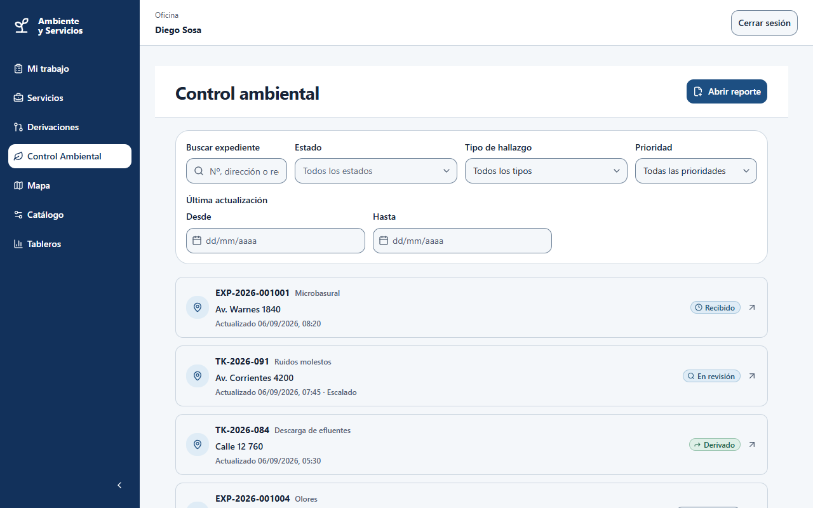

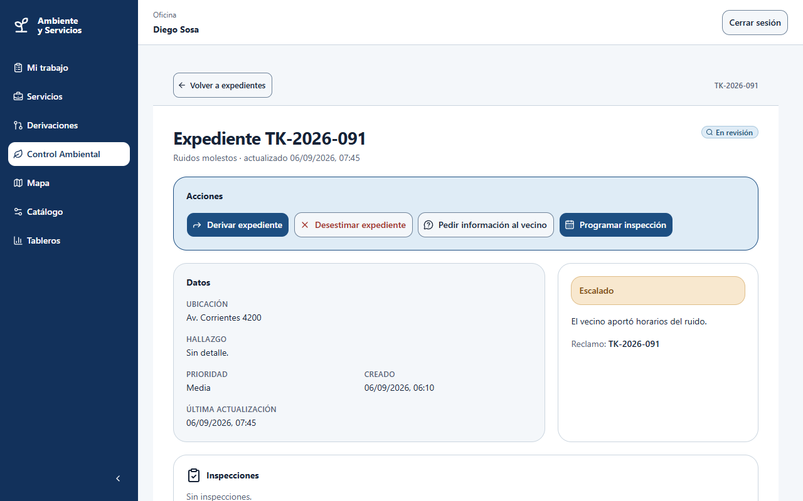

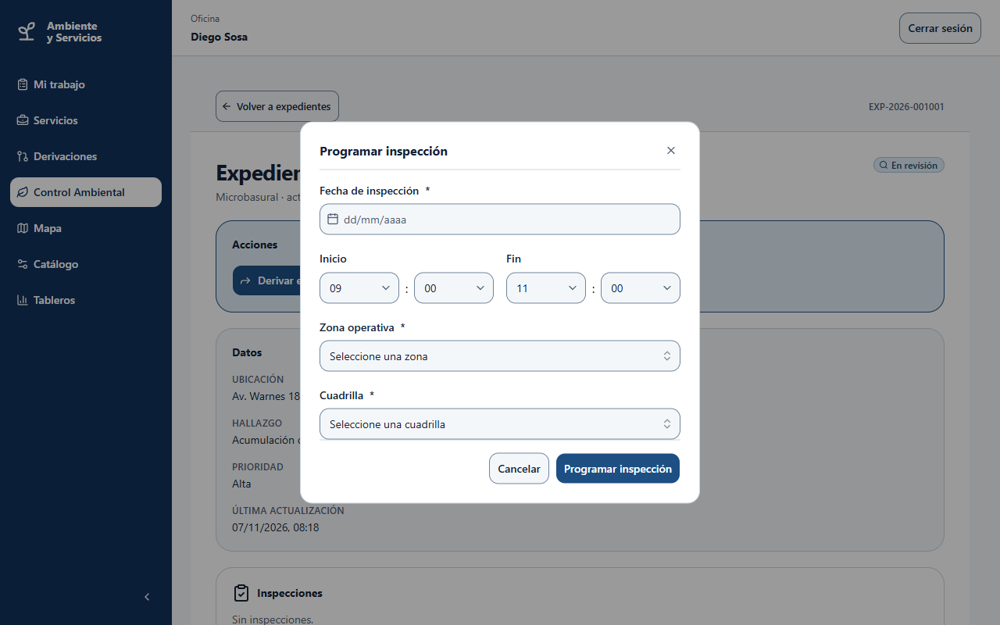

**Si algo falla:** al programar la inspección, *«Seleccione una zona.»* o *«Indique fecha, zona y cuadrilla.»* indican qué falta. Si ve *«El expediente cambió. Revise el estado actual.»*, otra persona cambió el expediente: revise las acciones disponibles.

### Tarea 8 — Registrar la inspección y emitir el acta

**8.A. Completar la inspección (Campo, inspector).** Cuenta: `carlos.medina.10011@municipio.gob.ar` (único con el rol de inspector entre las cuentas de prueba; un responsable de cuadrilla común no puede completar la inspección).

1. En **Mi trabajo** figuran los servicios **Inspección ambiental** de su cuadrilla. Pulse **Abrir** en el servicio de inspección y luego **Iniciar servicio** (arriba a la derecha). Hasta entonces el formulario está bloqueado (*«Inicie el servicio para registrar la inspección.»*).
2. Indique la **Fecha y hora de inspección** (se admite una diferencia de 5 minutos por el reloj del dispositivo).
3. Marque cada control del **Checklist de inspección** (*«Faltan controles por completar.»* mientras falten).
4. Elija el **Resultado de la inspección**: **Sin infracción**, **Infracción constatada** o **Inconclusa**. Con infracción, complete **Hallazgos**, **Tipo de infracción**, **Gravedad** y **Acción sugerida**. Con inconclusa, explique qué impidió confirmarlo.
5. Agregue la **Evidencia de la inspección** (tarea 6) y pulse **Completar inspección**.
6. Si el servicio de inspección sigue **En curso** (*«El servicio sigue abierto»*), registre el resultado de su zona con **Guardar zona** y pulse **Completar servicio**, como en los pasos 3 y 4 de la tarea 5.

**Resultado esperado:** el expediente pasa a **Inspeccionado** y luego a **Sin infracción**, **Infracción constatada** o queda para reinspección (si fue inconclusa).

**8.B. Emitir el acta (Oficina Ambiental).** Cuenta: `diego.sosa.10004@municipio.gob.ar`.

1. En un expediente con **Infracción constatada**, en el bloque **Acta de infracción**, pulse **Emitir acta**. Para emitirla, la inspección debe tener evidencia (*«Agregue evidencia a la inspección para emitir el acta.»*).
2. En la ventana (*«Verifique la inspección y elija el establecimiento. No se puede modificar.»*), use **Buscar establecimiento** y elija el establecimiento, y complete **Tipo de infracción**, **Gravedad** y **Acción sugerida**, todos obligatorios. **El acta no se puede modificar**: si hay un error se emite otra.
3. Pulse **Emitir acta**.

**Resultado esperado:** el expediente pasa a **Acta emitida** y el acta se envía a M4. La acción sugerida (**Advertencia**, **Aviso formal**, **Multa** o **Clausura**) **no es vinculante**: decide M4. Si no se encuentra el establecimiento, pulse **Continuar sin establecimiento**: la pantalla avisa *«El acta no se enviará a Faltas. El expediente se cierra.»* y el botón pasa a **Emitir sin establecimiento**.

Con resultado inconcluso, Oficina Ambiental usa **Programar reinspección** (se ve en el expediente **Inspeccionado**, con el aviso *«La anterior fue inconclusa. Programe otra.»*): se crea una nueva inspección y un nuevo servicio, y la anterior queda en la historia. En un expediente en **Inspección programada**, las cuentas de Operaciones y de administración ven además **Reprogramar inspección**. En el bloque **Inspecciones**, esas mismas cuentas ven **Crear derivación de reparación** (a M3) en las inspecciones donde el sistema la habilita.

### Tarea 9 — Registrar la sanción de M4 y cerrar el expediente (Oficina Ambiental)

**Dónde:** **Control Ambiental**, detalle del expediente. **Cuenta:** `diego.sosa.10004@municipio.gob.ar` (o la de administración).

1. M4 resuelve el acta y responde por el bus. **La sanción llega sola**: no se carga a mano. El expediente pasa a **Sancionado**.
2. Si el acta queda sin respuesta de M4 pasado el plazo, el expediente se **cierra solo**.
3. En los estados **Derivado**, **Desestimado**, **Sin infracción** y **Sancionado**, abra el expediente y pulse **Cerrar expediente**. Se abre una confirmación (*«El cierre es definitivo: no se puede reabrir desde la aplicación.»*; si hay un reclamo vinculado, avisa que se le notifica al vecino): pulse **Cerrar expediente** otra vez.

**Resultado esperado:** el expediente queda **Cerrado**. Un expediente **Sancionado** no se reabre; si el vecino rechaza la solución en M2, el expediente vuelve a **En revisión** (salvo si fue sancionado). La pantalla no tiene una acción para cargar una sanción a mano.

### Tarea 10 — Gestionar un contenedor (Oficina y Campo)

**Dónde:** menú **Catálogo** → **Contenedores** (con **Buscar contenedor** y los filtros **Estado**, **Tipo de contenedor** y **Zona**; **Registrar contenedor** da de alta uno). Pulse la fila del contenedor: se abre **Detalle del contenedor** con estado, tipo, capacidad, zona, coordenadas y dirección. Las acciones se agrupan en bloques: **Gestión** (**Editar**, para Oficina), **Operación** (reportar, vaciar, reubicar y confirmar ubicación), **Mantenimiento** (reparación) y **Destructivas** (retiro). **Cada acción es de un perfil distinto**: con la cuenta equivocada el botón no aparece (en Oficina, con el contenedor Activo o Desbordado, el detalle dice *«El desborde, el daño y el vaciado los registra la cuadrilla de campo.»*).

| Situación | Acción | Cuenta | Resultado esperado |
|---|---|---|---|
| **Activo** y se llenó | **Reportar desborde** → **Confirmar desborde** | Campo, responsable (`…10009`) | Pasa a **Desbordado** |
| **Desbordado** | **Vaciar contenedor** → **Confirmar vaciado** | Campo, responsable (`…10009`) | Vuelve a **Activo** |
| **Activo**, roto | **Reportar daño**: elija el **Tipo de daño** (estructura, quemado, tapa rota, ruedas rotas, vandalizado o faltante) y la **Severidad**, ambos obligatorios; **Confirmar daño** | Campo, responsable (`…10009`) | Pasa a **Dañado** |
| **Dañado** | **Iniciar reparación**; después, en **En reparación**, **Completar reparación** → **Confirmar reparación** | Oficina de Operaciones (`…10002`) o administración | Pasa por **En reparación** y vuelve a **Activo** |
| **Dañado** sin arreglo | **Retirar contenedor** → **Confirmar retiro** | Oficina de Operaciones (`…10002`) o administración | **Retirado** |
| **Activo**, hay que moverlo | **Reubicar** → **Iniciar reubicación** (no pide datos); después, en **En reubicación**, **Confirmar ubicación**: nueva dirección, **Latitud** y **Longitud**, y **Confirmar ubicación** | Oficina de Operaciones (`…10002`) o administración | Pasa por **En reubicación** y vuelve a **Activo** |

La cuenta de integrante (`…10010`) y la del inspector (`…10011`) también ven **Vaciar contenedor**; el inspector, además, **Reportar desborde** y **Reportar daño**. **Editar** (datos del contenedor) lo ofrece Oficina. Si hay un servicio en curso sobre el contenedor (por ejemplo, un vaciado programado como servicio puntual), el detalle muestra ese servicio en lugar del botón: el estado cambia al cerrar ese servicio. El código de un contenedor no se puede cambiar después de crearlo.

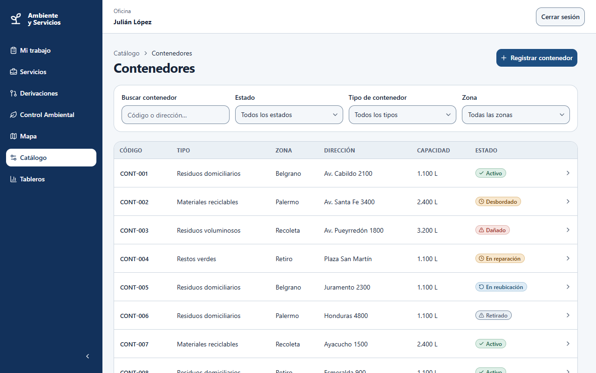

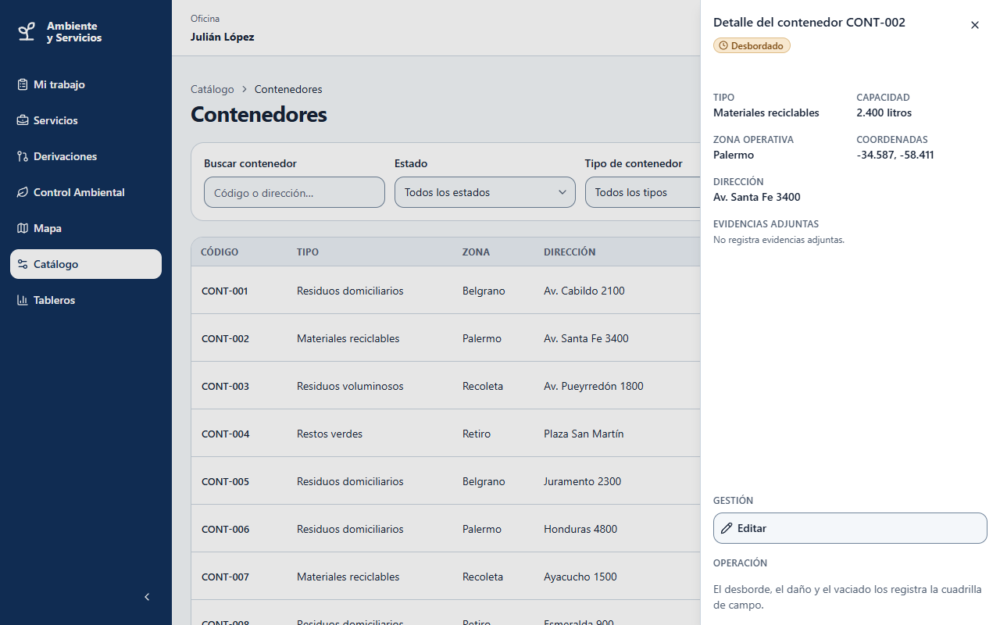

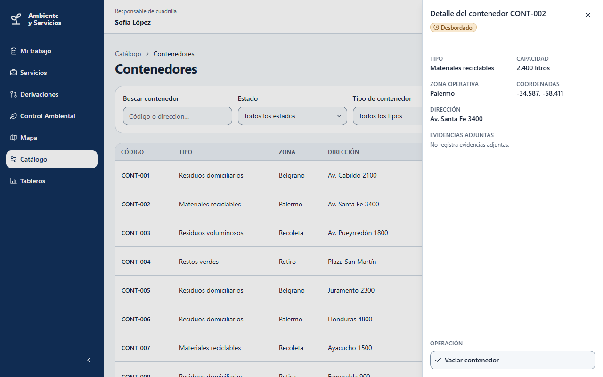

### Tarea 11 — Consultar el estado de una denuncia sin ingresar (vecino)

**Dónde:** `https://m6-ambiente-higiene.vercel.app/consulta` (no pide usuario; también se llega con **Consultar una denuncia**, al pie de la pantalla de ingreso).

1. Abra la dirección: se ve **Consultas para vecinas y vecinos** (en el encabezado, **Consulta ciudadana** e **Ingreso del personal**) con tres tarjetas, **Seguir mi denuncia**, **Servicios** y **Puntos verdes**, cada una con el enlace **Consultar**. Pulse **Consultar** en **Seguir mi denuncia**.
2. Escriba el **Código de seguimiento** (el del comprobante que le dio M2; se puede pegar tal cual) y pulse **Consultar**. La demostración no publica un código de ejemplo (los identificadores de reclamo de los datos de demostración son ficticios y no se muestran): para probar el caso feliz hace falta un comprobante real de M2.

**Resultado esperado:** se muestra la **etapa** de la denuncia, el tipo, la dirección y las fechas. **No** se muestran el inspector, los hallazgos ni el acta. Si el código no corresponde a ninguna denuncia, se muestra *«No encontramos una denuncia con ese código. Revisá que sea el código de seguimiento de tu comprobante.»*: no se revela si existe. Si el código no tiene formato de identificador, el aviso es *«Ese código no tiene el formato correcto. Copialo tal cual figura en tu comprobante.»*. Si se escribe el número de referencia `TK-…` en lugar del código, la pantalla explica que hace falta el código de seguimiento, que es otro. Hay un límite de consultas por minuto: si lo supera, aparece *«Hiciste muchas consultas seguidas. Probá de nuevo en un minuto.»*.

Las capturas son del entorno de demostración y muestran el aviso *«Entorno de demostración: los datos que ves no son los del servicio municipal real.»*; en la aplicación publicada ese aviso no aparece.

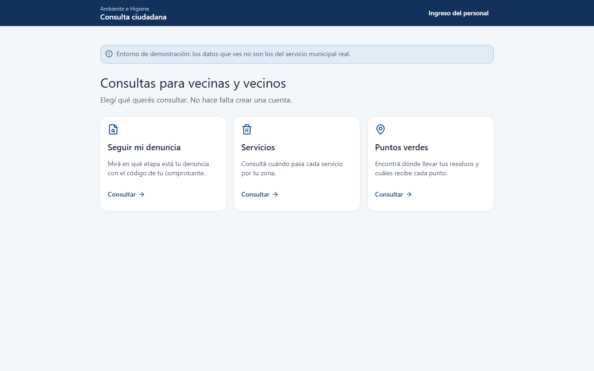

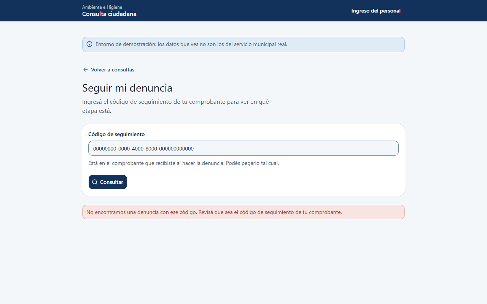

### Tarea 12 — Trabajar sin conexión (Campo)

1. Si una acción de Campo falla por falta de conexión, el formulario queda como **borrador local** en ese dispositivo, con el aviso *«Sin conexión. Se guardó en este dispositivo; reenvíe cuando vuelva la conexión.»*. En el detalle aparece la marca **Borrador local pendiente**; en la lista de **Mi trabajo**, **Sin enviar (sin conexión)**.
2. Cuando vuelva la señal, pulse **Reenviar** (el botón de la acción cambia a ese nombre). Nada se envía sin que usted lo confirme.
3. Si el servicio cambió mientras tanto (por ejemplo, Oficina lo reasignó), se abre la ventana **El servicio cambió** (*«Compare y elija qué hacer con lo que cargó.»*), que compara *Lo que cargó* con el *Estado actual*. Elija **Conservar para después** o **Descartar lo cargado**.

**Resultado esperado:** no se pierde nada; el borrador pertenece al usuario que lo escribió.

### Tarea 13 — Leer los indicadores (cualquier perfil)

**Dónde:** menú **Tableros**, que aparece para todos los perfiles.

1. Arriba, el botón **Más filtros · {período}** despliega los filtros: **Período** (**Semana**, **Mes** o **Trimestre**), **Desde**, **Hasta**, **Zona operativa** y **Tipo de servicio**. Pulse **Actualizar** para aplicarlos.
2. La pantalla muestra **Requiere atención** (**Servicios sin realizar**, **Servicios fuera de horario** y **Contenedores desbordados**, cada uno con su comparación con el período anterior), **Cobertura por semana** y **¿Dónde se concentra?** (por zona, con **Objetivos sin atención** y **Contenedores desbordados**).
3. Para ver una familia completa, pulse **Detalle por familia** y elija **Cobertura**, **Cumplimiento**, **Incidencias** o **Residuos**. **Volver a Tableros** regresa al resumen.
4. Los gráficos tienen un botón de ícono para alternar entre gráfico y tabla (**Ver tabla** / **Ver gráfico**). En el detalle de **Cobertura**, las tablas por tipo de servicio y por zona tienen **Exportar CSV**, que descarga los datos.

| Familia | Qué mide |
|---|---|
| Cobertura | Objetivos atendidos sobre programados |
| Cumplimiento | Servicios en fecha y ranking de zonas no atendidas con sus motivos |
| Incidencias | Contenedores desbordados y dañados, árboles por riesgo, tiempo medio de resolución de denuncias |
| Residuos | Kilos y metros cúbicos por tipo y destino; porcentaje desviado del relleno |

**Resultado esperado:** los gráficos reflejan el período y los filtros elegidos. Cada indicador compara con el período anterior y con la meta, cuando existe (*Cumple la meta* o *Bajo la meta*). La unidad de análisis es **servicio + zona**: un recorrido que pasa por cuatro zonas y atiende tres cuenta como tres objetivos atendidos y uno pendiente. Los servicios cancelados no cuentan como incumplimiento.

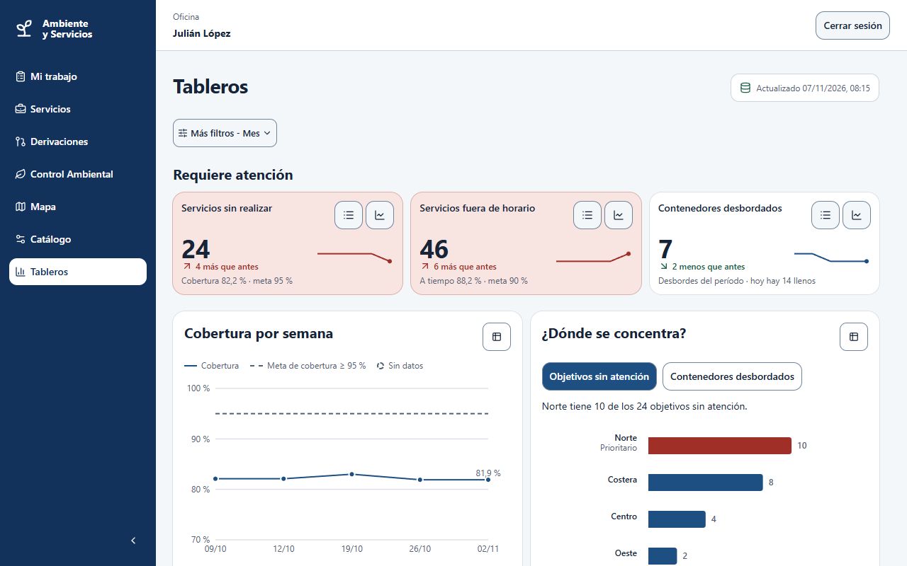

### Tarea 14 — Otras consultas y tareas de Oficina

Cuenta de Operaciones (`…10002`) salvo donde se indique.

- **Buscar y filtrar servicios:** en **Servicios**, escriba en la búsqueda («Buscar servicio, zona o cuadrilla…») o use los filtros **Período** (*Esta semana*, *Este mes*, *Todo el período* o *Período personalizado*), **Estado** (incluye *Fuera de horario*), **Comuna y barrio** y **Cuadrilla**; las columnas de la tabla también se filtran desde su encabezado. **Limpiar filtros** vuelve a la lista completa. **Categorías** no filtra: elige qué columnas muestra la tabla. El mapa y la tabla muestran lo mismo. Esta consulta la hace cualquier perfil (Campo ve solo los servicios de su cuadrilla).
- **Pedir un corte de calle o una reparación:** en el detalle de un servicio **Programado** o **A reprogramar**, **Solicitar corte de calle** (a M7; con el corte pendiente el servicio no puede iniciarse). **Crear derivación de reparación** (a M3) está en el detalle del servicio en cualquier estado. Las respuestas se siguen en **Derivaciones**.
- **Administrar catálogos:** **Catálogo** reúne tipos de servicio, sitios de disposición, zonas operativas, recorridos, frecuencias de servicio, vehículos, cuadrillas, espacios verdes, contenedores, puntos verdes, árboles e intervenciones de arbolado, cada uno con su botón **Abrir**. Todos los perfiles lo consultan. Operaciones (`…10002`) da de alta, edita y da de baja contenedores, puntos verdes, espacios verdes y árboles; los tipos de servicio, recorridos, frecuencias, cuadrillas, vehículos, zonas y sitios de disposición los administra la cuenta de **administración** (`…10000`). La baja es lógica y el código de un contenedor, un tipo de servicio o un relevamiento no se puede cambiar.
- **Intervenciones sobre arbolado:** en **Catálogo → Intervenciones de arbolado**, Operaciones pulsa **Solicitar intervención**. Una poda **Solicitada** la autoriza Operaciones directamente con **Autorizar intervención**. Una extracción necesita dos pasos: Operaciones pulsa **Enviar a autorización** (pasa a **Pendiente de autorización**) y la cuenta de **administración** (`…10000`) pulsa **Autorizar intervención** o **Rechazar intervención**. Para un relevamiento, abra el árbol y pulse **Registrar relevamiento** (acción de Campo).
- **Consultar el mapa:** **Mapa** (**Mapa operativo**) tiene las vistas **Inventario**, **Zonas**, **Cobertura**, **Recorrido** y **Hoy**, y las capas **Contenedores**, **Puntos verdes**, **Espacios verdes** y **Arbolado**, que se activan o desactivan. Toda la información del mapa también está en la lista **Elementos**.
- **Eventos** (antes «Monitor de integración»; ruta `/app/admin/integration-monitor`): aparece con la cuenta de administración y con la de auditoría, con las pestañas **Eventos salientes** (fallidos y reintento), **Eventos recibidos** (tipo, área emisora, estado, recibido, procesado, seguimiento y error) y **Registro de actividad** (el actor de un evento de otro módulo se ve como «Sistema · Obras Públicas», «Sistema · Tránsito», «Sistema · Faltas», «Sistema · Reclamos» o «Sistema · Alerta meteorológica»).
- **Accesos** (solo administración, `…10000`): busca a una persona por su identificador numérico (**Abrir persona**), muestra sus **Roles asignados** y permite cambiarlos (**Administrar**) o quitarlos (**Quitar todos los roles**). No se pueden combinar roles de Oficina y de Campo.

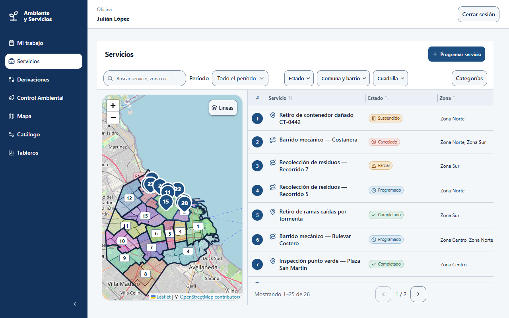
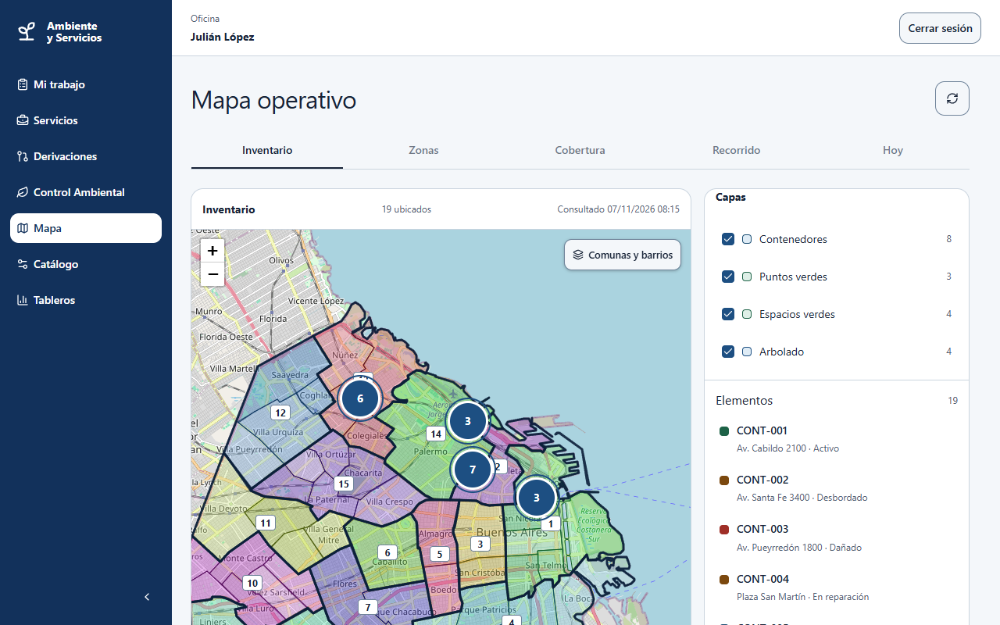

---

## 3. Qué hacer ante errores comunes

| Situación | Qué significa | Qué hacer |
|---|---|---|
| **401** (sesión vencida o inexistente) | La sesión venció o no existe | Pulse **Iniciar sesión**, o ingrese de nuevo desde la pantalla de ingreso, que muestra **Sesión terminada** · *«Su sesión terminó. Vuelva a ingresar.»* y lo lleva de vuelta a donde estaba |
| **403** | Su perfil no puede hacer eso (**ROLE_REQUIRED**), o el servicio o la inspección es de otra cuadrilla (**NOT_ASSIGNED**) | No es un error del sistema: pida a Oficina que lo haga o que lo reasigne. Un botón que falta casi siempre responde a la misma regla |
| **409** | El paso no corresponde al estado actual (por ejemplo, completar un servicio que ya se completó, o iniciarlo con un corte pendiente); suele pasar si otra persona cambió el registro | Recargue la pantalla y revise qué acciones ofrece ahora |
| **Sesión expirada en medio de una tarea** | La sesión venció mientras trabajaba | Vuelva a ingresar. Lo que haya quedado como borrador local (Campo) se conserva |
| **El backend tarda o no responde** (Render dormido) | Primer uso del día | Espere unos 30 segundos, pulse **Reintentar carga** o recargue. Al ingresar, el aviso indica que puede tardar hasta un minuto y medio |
| **No se pudo cargar la pantalla** · *«Revise la conexión e intente nuevamente.»* | Falló la carga inicial | Pulse **Reintentar carga**; si persiste, avise al equipo |
| *No se pudo subir el archivo. Intente nuevamente.* | Falló la subida | Pulse **Reintentar** (zona) o **Reintentar carga** (inspección) y verifique que sea JPEG, PNG, WebP o PDF de hasta 4 MB |
| Recuadro **Revise la asignación** | La cuadrilla es de otra zona o especialidad, o la cuadrilla o el vehículo ya tienen otro servicio ese día | Escriba la **Justificación de la asignación** (de 10 a 500 caracteres; con menos: *«Escriba al menos 10 caracteres.»*) o elija otra cuadrilla |
| Ventana **El servicio cambió** | El servicio cambió mientras trabajaba sin conexión | Compare *Lo que cargó* con el *Estado actual* y elija **Conservar para después** o **Descartar lo cargado** |
| *No se pudieron cargar las derivaciones.* | Falló la consulta | Cierre y vuelva a abrir el servicio |

Soporte: abra un Issue en el repositorio ([Frontend](https://github.com/hllous/Frontend-M6-DAPS2) o [Backend](https://github.com/hllous/Backend-M6-DAPS2)) con una captura y los pasos para reproducirlo.

---

## 4. Referencia rápida de estados

### 4.1 Servicio

| Estado | Qué puede hacer cada rol |
|---|---|
| **Programado** | Oficina: asignar, reprogramar (con fecha nueva), cancelar. Responsable de cuadrilla: iniciar |
| **A reprogramar** | Oficina: confirmar nueva fecha, asignar, cancelar |
| **En curso** | Responsable de cuadrilla: registrar zonas, suspender, completar |
| **Suspendido** | Responsable de cuadrilla: reanudar. Oficina: cancelar |
| **Completado**, **Parcial**, **Cancelado** | Estados finales |

«Demorado» **no es un estado**: un servicio demorado sigue **Programado** o **En curso**. Un servicio pasa a **A reprogramar** solo, cuando M7 rechaza un corte de calle o entra una alerta meteorológica; **Reprogramar** desde Oficina no lo deja en ese estado, porque pide la fecha nueva en el mismo paso.

### 4.2 Expediente ambiental

Recibido → En revisión → (Inspección programada → Inspeccionado → Sin infracción | Infracción constatada | reinspección) → Acta emitida → Sancionado → Cerrado. Desde **En revisión** también se puede pasar a **Derivado** o **Desestimado**.

### 4.3 Contenedor

Activo, Desbordado, Dañado, En reparación, En reubicación, Retirado.

### 4.4 Resultado de una zona

| Resultado | Pide motivo | Pide evidencia |
|---|---|---|
| Atendida | No | Opcional |
| Parcial | Sí | Sí |
| No atendida | Sí | Sí |

### 4.5 Qué ve cada perfil

| Función | Oficina de Operaciones | Oficina Ambiental | Administración | Auditoría | Responsable de cuadrilla | Inspector | Integrante |
|---|---|---|---|---|---|---|---|
| Ver servicios, mapa, expedientes y tableros | ✔ | ✔ | ✔ | ✔ | ✔ (servicios de su cuadrilla) | ✔ | ✔ |
| Programar, asignar, reprogramar, cancelar servicios | ✔ | — | ✔ | — | — | — | — |
| Iniciar, suspender, completar servicios | — | — | — | — | ✔ (su cuadrilla) | ✔ (su cuadrilla) | la pantalla no lo ofrece |
| Completar inspecciones | — | — | — | — | — | ✔ | — |
| Reportar desborde o daño, vaciar contenedores | — | — | — | — | ✔ | ✔ | ✔ (vaciar) |
| Reparar, reubicar y retirar contenedores | ✔ | — | ✔ | — | — | — | — |
| Clasificar denuncias y emitir actas | — | ✔ | ✔ | — | — | — | — |
| Abrir un expediente de oficio | — | ✔ | ✔ | — | — | ✔ | — |
| Autorizar una poda | ✔ | — | ✔ | — | — | — | — |
| Autorizar o rechazar una extracción de árbol | — | — | ✔ | — | — | — | — |
| Administrar tipos de servicio, recorridos, cuadrillas y demás catálogos | — | — | ✔ | — | — | — | — |
| Ver Eventos | — | — | ✔ | ✔ | — | — | — |
| Asignar roles (Accesos) | — | — | ✔ | — | — | — | — |

Estas reglas dependen de la cuenta (ver 1.4). Las acciones que la pantalla no ofrece, el servidor las rechaza con 403 cuando el perfil no tiene el rol; para el integrante de cuadrilla la documentación del servidor le da el mismo rol de Campo que al responsable, de modo que **la pantalla no lo ofrece** pero eso no es una garantía de que el servidor lo impida.

---

## 5. Limitaciones conocidas

- **Catálogo de barrios:** la lista usada para armar zonas es provisoria hasta conectar el catálogo de M9.
- **Establecimientos:** la búsqueda al emitir un acta usa una lista local hasta que M4 publique la suya.
- **Aviso de demora:** el servidor lo soporta, pero la pantalla todavía no lo ofrece.
- **Exportación:** solo el detalle de **Cobertura** en **Tableros** exporta (**Exportar CSV**); el resto de las pantallas no.
- **PDF adjuntos:** no se limpian de metadatos ni se analizan en busca de virus.
- **Campo y el catálogo:** el menú de Campo incluye **Catálogo** porque cualquier perfil lo consulta; Campo no administra el catálogo.

---

## 6. Trazabilidad: tarea del manual → historia de usuario

Las HU son las del tablero «M6 - Product Backlog & Story Map» de Trello; sus identificadores `HU-01` a `HU-33` y sus criterios están en `02-historias-y-criterios.md`. La columna «Historia de usuario» cita el título en Trello; la tabla ya está conciliada con esos identificadores.

| Tarea del manual | Historia de usuario |
|---|---|
| 1 Ingresar y reconocer su rol | HU-29, HU-30: Como Oficina y como Campo quiero ver y hacer solo lo que mi rol permite, con el rol que viene de M1; Activar la autenticación real de M1 con sesión sellada en el BFF |
| 2 Programar un servicio | HU-05: Como Oficina quiero programar un servicio sobre un recorrido o un punto, con fecha, franja y cuadrilla |
| 3 Asignar cuadrilla y vehículo | HU-05, HU-03: Como Oficina quiero programar un servicio sobre un recorrido o un punto…; Como Oficina quiero administrar tipos de servicio, frecuencias, cuadrillas, vehículos y sitios de disposición |
| 4 Reprogramar o cancelar | HU-06, HU-04: Como Oficina quiero reprogramar o cancelar un servicio con motivo; Como Oficina quiero que al suspender un servicio el motivo y la nota se guarden por separado |
| 5 Ejecutar un servicio | HU-07: Como líder de cuadrilla quiero iniciar el servicio, registrar el resultado de cada zona y cerrarlo |
| 6 Adjuntar evidencia | HU-08: Como miembro de cuadrilla quiero adjuntar fotos como evidencia, con reintento seguro |
| 7 Recibir y asignar una denuncia | HU-15, HU-14: Como Oficina quiero recibir denuncias ambientales y asignarlas a una cuadrilla para inspeccionarlas; Como Oficina quiero filtrar la cola de denuncias por rango de fechas |
| 8 Inspección y acta | HU-16: Como inspector quiero registrar la inspección y emitir el acta de constatación |
| 9 Sanción de M4 y cierre | HU-17: Como Oficina quiero registrar la sanción que devuelve M4 y cerrar el expediente |
| 10 Gestionar un contenedor | HU-11: Como Oficina quiero gestionar contenedores (desborde, daño, vaciado, reparación y reubicación) |
| 11 Consulta del vecino sin ingresar | HU-27: Como vecino quiero consultar sin login el estado de mi denuncia, cuándo pasa el servicio y dónde están los puntos verdes |
| 12 Trabajar sin conexión | HU-08: Como miembro de cuadrilla quiero adjuntar fotos como evidencia, con reintento seguro |
| 13 Leer los indicadores | HU-28: Como Oficina quiero un tablero de indicadores (cobertura, cumplimiento, incidencias y residuos) |
| 14 Otras tareas de Oficina | HU-12, HU-13, HU-09: Como Oficina quiero llevar el censo de arbolado…; Como Oficina quiero administrar espacios verdes y puntos verdes; Como cuadrilla quiero derivar una reparación o pedir un corte de calle |
