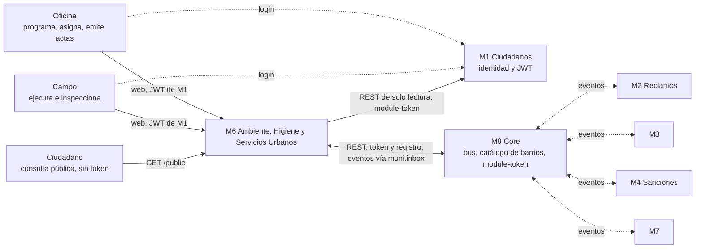
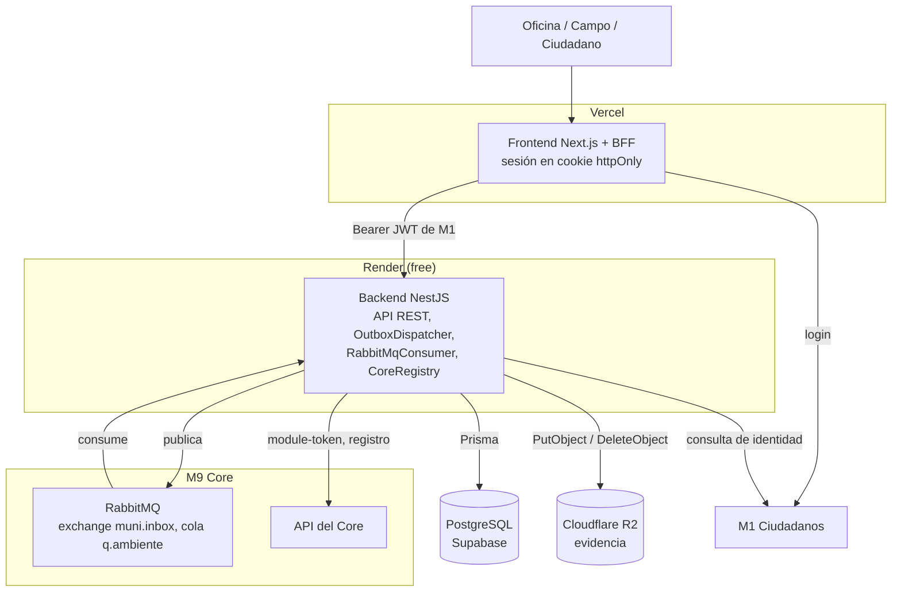
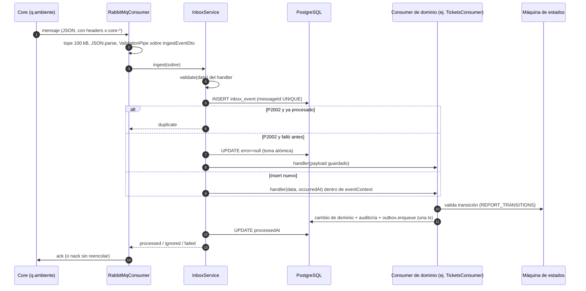
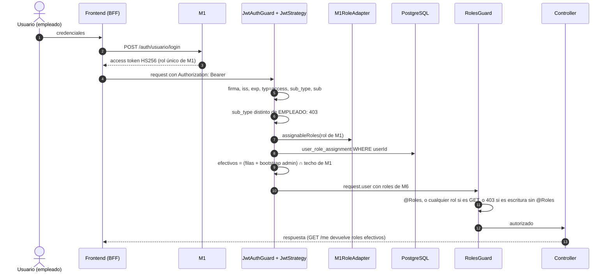

# Arquitectura de M6

> Vistas C4 (contexto y contenedores) y tres secuencias del flujo de eventos y de auth. Mermaid, sin herramientas externas. El código manda: cada flecha cita debajo el `archivo:línea` que la implementa (rama `develop`, 7/11/2026). Decisiones de fondo: [ADR-004](../decisiones/adr-004-jwt-m1-y-puerto-identidad.md), [ADR-006](../decisiones/adr-006-rabbitmq-como-bus.md), [ADR-007](../decisiones/adr-007-contrato-de-integracion-del-core.md), [ADR-008](../decisiones/adr-008-roles-m6-adaptados-desde-m1.md), [ADR-009](../decisiones/adr-009-rest-m6-a-m1-consultas-de-identidad.md). Estado de cada integración: [bloqueantes.md](../bloqueantes.md).

## 1. C4 nivel 1: contexto



Las líneas punteadas son asincrónicas o ajenas a M6. M6 nunca habla directo con M2, M3, M4 o M7: todo pasa por el bus del Core. Qué intercambia con cada uno: [integracion/](../integracion/README.md).

| Flecha | Implementación |
|---|---|
| Oficina/Campo/Ciudadano -> M6 | Guards globales `src/app.module.ts:84-85`; lo público lleva `@Public()` (`src/common/guards/jwt-auth.guard.ts:21-27`) |
| M6 -> M1 (REST de identidad) | `src/identity/m1-identity.client.ts:56` (`findEmployeeBySub`), `:98-99` (Bearer con el module-token) |
| M6 <-> M9 (REST) | Token: `src/core/core.client.ts:111-114` (`/api/v1/auth/module-token`); registro de suscripciones y publicaciones: `src/core/core-registry.service.ts:86-95` |
| M6 <-> M9 (eventos) | Secciones 3.1 y 3.2 |
| Login contra M1 | **No verificado en este repo:** lo hace el frontend (ADR-005, [integracion/m1.md](../integracion/m1.md)); acá solo se valida el token (sección 3.3) |

## 2. C4 nivel 2: contenedores



| Flecha | Implementación |
|---|---|
| Frontend -> Backend con Bearer | `src/auth/jwt.strategy.ts:51` (`fromAuthHeaderAsBearerToken`); el BFF es del repo `Frontend-M6-DAPS2` (ADR-005): **no verificado desde acá** |
| Backend -> PostgreSQL | `PrismaService` (`src/prisma/`); Supabase y Render según [deploy.md](../deploy.md) (no se deduce del código) |
| Backend -> R2 | `src/modules/attachments/storage/r2-evidence.storage.ts:54` (`PutObjectCommand`), `:74` (`remove`); lo invoca `src/modules/attachments/attachments.service.ts:101` desde `POST /evidence` (`attachments.controller.ts:36`) |
| Backend -> RabbitMQ | `src/events/publishers/rabbitmq.publisher.ts:45`; fábrica en `src/events/events.module.ts:29-53` (sin `RABBITMQ_URL` publica a log, `:37`) |
| RabbitMQ -> Backend | `src/events/consumers/rabbitmq.consumer.ts:110`; sin `RABBITMQ_URL` no se crea el consumer (`createRabbitMqConsumer` en `events.module.ts`) |
| Backend -> API del Core | `src/core/core.client.ts:111-114`; registro al arrancar: `src/core/core-registry.service.ts:71-77` |
| Backend -> M1 | `src/identity/m1-identity.client.ts:98-99`; sin `M1_BASE_URL` el cliente queda deshabilitado y la app arranca igual (ADR-009) |

## 3. Secuencias

### 3.1 Publicar un evento

```mermaid
sequenceDiagram
  autonumber
  participant S as Service de dominio
  participant DB as PostgreSQL
  participant D as OutboxDispatcher
  participant P as RabbitMqEventPublisher
  participant X as muni.inbox (Core)

  S->>DB: BEGIN (prisma.$transaction)
  S->>DB: cambio de dominio + historial + auditoría
  S->>DB: outbox.enqueue(tx): INSERT outbox_event PENDING
  S->>DB: COMMIT (todo o nada)
  loop cada 10 s
    D->>DB: SELECT PENDING ORDER BY occurredAt LIMIT 50
    D->>P: publish(sobre, eventId = id de la fila)
    P->>X: basic.publish (persistent, mandatory)
    X-->>P: confirm (ack) o basic.return / nack
    alt confirmado
      D->>DB: UPDATE status SENT, publishedAt
    else falla
      D->>DB: attempts+1; PENDING, o FAILED al 5.º intento
    end
  end
```

| Paso | Implementación |
|---|---|
| 1-4: cambio y fila en la misma transacción | Ejemplo: `src/modules/containers/containers.service.ts:346` (transacción), `:358` (historial), `:362` (auditoría), `:372` (`outbox.enqueue(tx, ...)`). `enqueue` exige el `tx` y solo inserta (`src/events/outbox/outbox.service.ts:43-45`; `enqueueMany` `:49-57`). Para `updateTicketStatus` además anota el estado del ticket en la misma tx (`:66-76`) |
| Correlación | `correlationId`/`causationId` salen de `eventContext`, no del dominio (`outbox.service.ts:78-87`); en HTTP los abre `EventTraceInterceptor` (`src/configure-app.ts:33`) |
| 5-6: barrido | `src/events/outbox/outbox-dispatcher.service.ts:42-48` (`@Interval(10_000)`, `PENDING`, `occurredAt asc`; `BATCH_SIZE = 50` en `:10`) |
| 7: sobre con `eventId` = id de la fila | `outbox-dispatcher.service.ts:58-69` (`buildEnvelope`, `eventId` en `:64`): si se publica dos veces por un corte, el consumidor deduplica |
| 8: publicación | `src/events/publishers/rabbitmq.publisher.ts:35-62`: exchange de `RABBITMQ_EXCHANGE` (default `muni.inbox`, `src/config/env.validation.ts:126`), routing key = `eventType` (el fanout la ignora), `persistent` y `mandatory` |
| 9: confirm o return | `rabbitmq.publisher.ts:63-77` (resuelve solo si hubo confirm y el mensaje no volvió); `basic.return` registrado en `:112-115` |
| 10: `SENT` | `outbox-dispatcher.service.ts:74-82` |
| 11: reintento / `FAILED` | `outbox-dispatcher.service.ts:83-104`; `MAX_ATTEMPTS = 5` en `:18` |
| Sin broker | El publisher conecta de forma perezosa (`rabbitmq.publisher.ts:89`): un broker caído no tira la API y el outbox acumula |

### 3.2 Consumir un evento



| Paso | Implementación |
|---|---|
| 1: cola y consumo | Cola `q.ambiente` creada por el Core, solo se verifica: `src/events/consumers/rabbitmq.consumer.ts:103` (`checkQueue`), `:109-110` (`prefetch`, `consume`) |
| 2: validación de entrada | `rabbitmq.consumer.ts:159` (100 kB), `:164-167` (`JSON.parse` y pipes globales). Mismo camino que `POST /events/inbox` (`src/events/inbox/inbox.controller.ts:53`) |
| 3-4: validación del handler | `src/events/inbox/inbox.service.ts:130-136` (400 sin fila guardada) |
| 5: idempotencia | `inbox.service.ts:157-166` (`create`; `messageId` es `@unique`, decide la base) |
| 6-7: duplicado o reintento | `inbox.service.ts:168-190` (P2002, `updateMany` condicional, `duplicate`); reintento con el payload guardado `:199-206` |
| 8: handler en `eventContext` | `inbox.service.ts:209-222` (sin handler: `ignored`, `:210-218`). Registro: `src/events/consumers/tickets.consumer.ts:125` |
| Despacho por `updateType` | `tickets.consumer.ts:162` (`handle`), `:226-243` (`switch`; siete tipos se descartan a propósito) |
| 9: máquina de estados | `src/modules/environmental-reports/environmental-reports.service.ts:44-59` (`REPORT_TRANSITIONS`), `:520-529` (`assertTransition`); el consumer la consulta en `tickets.consumer.ts:673` y filtra por estado en el `where` de los `updateMany` (`:393-404`) |
| 10: cambio y evento en una tx | `tickets.consumer.ts:393` y `:443` (`$transaction`); el evento hereda `correlationId` y su causa es el `eventId` (`src/events/event-context.ts:53-59`) |
| 11: `processedAt` | `inbox.service.ts:223`, `:268-272` |
| Fallo del handler | `inbox.service.ts:226-236`: queda sin `processedAt` y con `error`; devuelve `failed` |
| 12: ack / nack | `rabbitmq.consumer.ts:169` (`failed` -> `nack`), `:138-139`; `nack` siempre con `requeue=false`: los reintentos y la DLQ son del Core |

### 3.3 Login con JWT de M1 y rol local



| Paso | Implementación |
|---|---|
| 2-3: login | Lo hace el frontend contra M1 (ADR-004 y ADR-005; verificado de punta a punta el 3/11 según [integracion/m1.md](../integracion/m1.md)). **No hay código de login en este repo**: M6 no emite JWT |
| 4-5: Bearer y verificación | `src/auth/jwt.strategy.ts:50-58`: secreto base64 decodificado, solo `HS256`/`HS384`/`HS512`, `iss` y `exp` obligatorios |
| 5: claims | `jwt.strategy.ts:64-72`: `typ === 'access'`, `exp`, `rol`, `sub_type` en `CIUDADANO`/`EMPLEADO`, `sub` numérico |
| 6: solo empleados | `src/common/guards/jwt-auth.guard.ts:30-37` (un ciudadano con token válido recibe 403; sin token o inválido, 401). `@Public()` salta el guard (`:21-27`) |
| 7: techo del rol de M1 | `src/auth/m1-role.adapter.ts:14-22` (`ASIGNABLES`), `:30-40` (`assignableRoles`; rol desconocido = sin acceso) |
| 8-9: roles efectivos | `jwt.strategy.ts:88-107` (`effectiveRoles`): la tabla se lee en cada request, sin caché (`:91`); Oficina y Campo no conviven (`:100-105`, ADR-005) |
| 10: `request.user` | `jwt.strategy.ts:73-80` (`AuthenticatedUser`) |
| 11: autorización por rol | `src/common/guards/roles.guard.ts:28-54`: `@Roles` (`:40-41`), GET/HEAD con cualquier rol (`:42-43`), escritura sin `@Roles` falla cerrado (`:44-46`). Orden: `JwtAuthGuard` primero (`src/app.module.ts:84-85`) |
| 12: `GET /me` | `src/auth/me.controller.ts:73`, `src/auth/me.service.ts:9` |

## 4. Diferencias entre los ADR y el código

El código manda; estas son las que importan al leer los ADR.

| ADR | Dice | El código hace |
|---|---|---|
| [ADR-004](../decisiones/adr-004-jwt-m1-y-puerto-identidad.md) (decisión original) | M6 no consulta a M1 hasta que exista un caso de uso | Ya lo consulta por REST con el module-token del Core (ADR-009, `src/identity/`); lo vigente está en las notas posteriores |
| [ADR-004](../decisiones/adr-004-jwt-m1-y-puerto-identidad.md) (nota 21/10) | `rol` queda en `request.user` como `roles: [rol]` | `request.user.roles` son los roles de M6 efectivos y el rol de M1 va aparte en `m1Role` (`jwt.strategy.ts:73-80`, ADR-008) |
| [ADR-006](../decisiones/adr-006-rabbitmq-como-bus.md) | M6 se comunica solo por eventos | Además hace REST al Core (token, registro) y a M1 (identidad); ADR-007 y ADR-009 lo acotan |
| Patrón inbox | Idempotencia por inbox | Es por `messageId` único al insertar, pero la fila del inbox y el efecto del handler **no** van en una misma transacción (`inbox.service.ts:157` y `:222-223`): cada handler tiene que tolerar correr de nuevo (`:13-19`), y si el proceso muere a mitad queda una fila sin `processedAt` ni `error` que nadie retoma (`ponytail` en `:173-176`) |
| Outbox | Publicación confiable | Es *at-least-once* con un solo dispatcher y sin lock (`outbox-dispatcher.service.ts`, comentario `ponytail` sobre la clase); válido con una sola réplica en Render |

## 5. Qué no se pudo verificar

- El BFF y el login contra M1 viven en `Frontend-M6-DAPS2` y en M1; acá solo se verificó la validación del token.
- Supabase, Render y Vercel salen de [deploy.md](../deploy.md), no del código (no se contrastaron `Dockerfile` ni workflows para este documento).
- Los números de línea corresponden a `develop` al 7/11/2026 y se desfasan con cada cambio; ante duda, buscar el símbolo.
