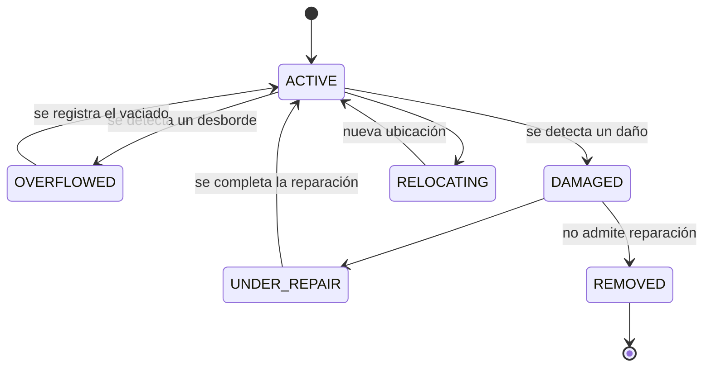

# `Container` — contenedores

Los contenedores de la vía pública, con su ciclo de desborde, daño, reparación y reubicación. Los puntos verdes de entrega voluntaria (`GreenPoint`) son otra cosa y están en [inventario-urbano.md](inventario-urbano.md).

## Campos

| Entidad | Campos principales |
|---|---|
| `Container` | `code`, `containerType`, `location`, `capacityLiters`, `zoneId`, `status`, y con el estado `DAMAGED` también `damageType`, `severity`, `requiresPublicWorks` |

Enums: `containerType` es `ContainerType`, `status` es `ContainerStatus`, `damageType` es `DamageType`, `severity` es `Severity` — ver [enumeraciones.md](../enumeraciones.md). `zoneId` → [`Zone`](configuracion-y-recursos.md#zone).

Los tres campos de daño se llenan solo al pasar a `DAMAGED`. **`requiresPublicWorks = true` marca el componente de infraestructura civil que no nos corresponde** —la base rota, la vereda hundida— y es la señal que hace que el evento le sirva a M3.

## Estados

El vaciado y la reubicación se ejecutan como [`Service`](service.md) con `mode = POINT` y `targetRef` apuntando al contenedor.

**Cerrar ese servicio *es* la transición del contenedor**, no un paso aparte: `POST /services/:id/complete` mueve los dos en la misma transacción. La transición se deriva del estado en que está el contenedor, porque es el estado el que dice qué trabajo estaba pendiente:

| Estado al cerrar | Queda | Necesita |
|---|---|---|
| `OVERFLOWED` | `ACTIVE` | nada — es el vaciado |
| `UNDER_REPAIR` | `ACTIVE` | nada — es la reparación terminada |
| `RELOCATING` | `ACTIVE` | `containerLocation` en el body: la ubicación nueva no viaja en el `Service` |
| `ACTIVE`, `DAMAGED`, `REMOVED` | sin cambio | no había trabajo pendiente que cerrar |

Un cierre `PARTIALLY_COMPLETED` no transiciona el contenedor: el trabajo no se hizo.

## Historial de estados (#475)

`Container` solo guarda el estado actual: cada transición pisa el anterior. Para poder contar desbordes y daños **en el tiempo** (tablero de indicadores), cada alta y cada transición deja una fila en `container_status_history`, escrita **en la misma transacción** que el cambio.

| Campo | Qué es |
|---|---|
| `containerId` | El contenedor |
| `fromStatus` | Estado de origen. **`null` en el alta y en la fila base de la migración**: esas filas sirven para reconstruir el estado y **nunca cuentan como incidente** |
| `toStatus` | Estado de destino |
| `changedAt` | Instante del cambio |

Índices: `(containerId, changedAt)` para reconstruir el último estado, y `(toStatus, changedAt)` para contar incidentes.

- **Quién lo escribe:** `ContainersService`, en las ocho acciones (`reportOverflow`, `empty`, `reportDamage`, `startRepair`, `completeRepair`, `relocate`, `confirmRelocation`, `remove`) y en el alta (`create`: origen nulo, destino `ACTIVE`). La fila va junto al `outbox` cuando lo hay (`containerDamaged`): si una falla, no queda ninguna de las dos. Se mantiene el control de concurrencia (el estado leído va en el `where` del update) y la fila se escribe solo si el update aplicó, así que un 409 no deja filas. Los endpoints no cambian: respuestas, validaciones y códigos de error son los mismos.
- **Migración** (`20261030120000_container_status_history`): crea la tabla y siembra **una fila base por contenedor existente** (origen nulo, destino su estado actual, instante de la migración). No se reconstruyen desbordes ni daños anteriores: el historial empieza el día del despliegue y antes de eso el indicador dice «sin dato» (`null`), no cero.
- **Sin actor:** quién hizo cada cambio es el alcance de #460 y no se adelanta acá.
- **Qué se mide con esto:** incidentes de desborde (`OVERFLOWED`) y de daño (`DAMAGED`) por período, y daños pendientes (último estado `DAMAGED` o `UNDER_REPAIR`) al fin de cada período. Definiciones en [endpoints.md](../api/endpoints.md#definición-de-cada-indicador).
- **Hueco conocido:** `POST /services/:id/complete` también mueve el contenedor (`OVERFLOWED`/`UNDER_REPAIR`/`RELOCATING` → `ACTIVE`) desde `ServicesService`, **no** desde `ContainersService`. Esa vía todavía no escribe en el historial (ver el estado del seguimiento en el PR de #475).

## Qué publica

- Al pasar a `DAMAGED`: [`containerDamaged`](../eventos/publicados/containerDamaged.md) → M3.
- Al pasar a `OVERFLOWED`: **nada sale al bus** (`containerOverflowed` está [descartado](../eventos/publicados/descartados.md)). Si el desborde lo reportó un vecino hay `ticketId` y sale un [`updateTicketStatus`](../eventos/publicados/updateTicketStatus.md) hacia M2; si lo detectamos nosotros en la recorrida, no hay reclamo al que contestarle y no sale nada.
