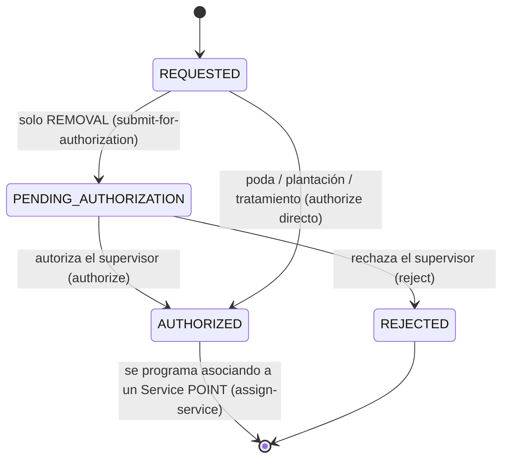

# `TreeIntervention` — poda, extracción, plantación, tratamiento

Qué hay que hacerle a uno o varios árboles. El **cuándo** y el **con qué cuadrilla** los pone el [`Service`](service.md) que la ejecuta: la intervención guarda la decisión, el servicio guarda la ejecución.

El árbol y su historial de relevamientos están en [inventario-urbano.md](inventario-urbano.md).

## Campos

| Entidad | Campos principales |
|---|---|
| `TreeIntervention` | `interventionType`, `treeIds[]`, `location`, `requiresStreetClosure`, `status`, `priority`, `serviceId`, `pruningScheduledAt` (columna que quedó de la marca de emisión de `treePruningScheduled`; ya no se usa para emitir), `requestedByUserId` (quien la solicitó, del token) y, al autorizarse, `authorizedByUserId`, `authorizedAt` (también en las podas, que se autorizan directo) y `justification` |

Enums: `interventionType` es `TreeInterventionType`, `status` es `TreeInterventionStatus` — ver [enumeraciones.md](../enumeraciones.md). La [divergencia 4](../enumeraciones.md#divergencias-con-el-acuerdo-publicado--resueltas) sobre `interventionType` quedó resuelta a favor del catálogo ([ADR-003](../decisiones/adr-003-divergencias-enums.md)).

## Estados

Toda intervención debe alcanzar el estado `AUTHORIZED` antes de poder asociarse a un [`Service`](service.md) de modo `POINT` mediante `POST /tree-interventions/:id/assign-service`. La extracción (`REMOVAL`) exige un paso intermedio de supervisión obligatoria (`PENDING_AUTHORIZATION`) con justificación; el resto de intervenciones pasa directo de `REQUESTED` a `AUTHORIZED`.

Autorizar o rechazar una extracción exige `M6_ADMIN` (el responsable de área); quien la solicita (`M6_OFICINA_OPERACIONES`) no puede decidirla. Un admin puede autorizar lo que él mismo solicitó: queda registrado en `requestedByUserId`. Las podas no requieren autorización. Los campos de auditoría de autorización (`authorizedByUserId`, `authorizedAt`) se registran al pasar a `AUTHORIZED`, sea extracción o poda (las podas quedan autorizadas por quien llama a `authorize`, sin exigir `M6_ADMIN`). `justification` es obligatoria para `REMOVAL`. El estado terminal de esta entidad es quedar asociada a un servicio (`serviceId` asignado); a partir de ahí el avance operativo se sigue desde el [`Service`](service.md#estados).

## Qué publica

- Al programarse la poda no sale nada hacia M7: `treePruningScheduled` se dejó de emitir el 21/10 ([descartados](../eventos/publicados/descartados.md)).
- Si `requiresStreetClosure = true`, el corte no sale solo: se pide aparte con `POST /street-closure-requests` (`sourceType = TREE_INTERVENTION`), que exige la intervención en `AUTHORIZED` y publica [`streetClosureRequested`](../eventos/publicados/streetClosureRequested.md) → M7 con `sourceRef` apuntando a esta intervención.
