# Manual de usuario — Módulo 6: Ambiente, Higiene y Servicios Urbanos

> Actividad integradora de la Clase 12 (20/10/2026), Parte B, punto 6. Se redacta para el usuario final y sigue la estructura de ISO/IEC/IEEE 26514; cada sección está clasificada según el marco Diátaxis (Tutorial, Guía práctica, Referencia, Explicación).
> Fuente: se escribió a partir de la aplicación (repositorio `Frontend-M6-DAPS2`) y de la documentación del backend (`docs/`). Las capturas son de la app real en modo demostración, con datos de ejemplo.

---

## 1. Portada

| | |
|---|---|
| **Producto** | Aplicación web de Ambiente y Servicios — Módulo 6 (Grupo 04), Municipalidad UADE |
| **Versión del manual** | 0.1 (borrador para el 3er Check point, 27/10/2026) |
| **Fecha** | 20/10/2026 |
| **Público** | Personal municipal de **Oficina** y de **Campo** (responsables e integrantes de cuadrilla) |
| **Idioma de la aplicación** | Español |

**Cómo usar este manual.** Si es la primera vez, haga el [Tutorial](#4-primeros-pasos-tutorial) completo. Si busca resolver una tarea concreta, vaya al apartado de su rol: [Oficina](#5-tareas-de-oficina) o [Campo](#6-tareas-de-campo). Si ve un mensaje que no entiende, consulte [Mensajes de error](#9-mensajes-de-error-y-qué-hacer).

---

## 2. Qué es esta aplicación y para quién

*Tipo Diátaxis: Explicación.*

La aplicación reúne en un solo lugar el trabajo del área de Ambiente, Higiene y Servicios Urbanos de la Municipalidad:

- **Servicios**: recolección de residuos, barrido y lavado de calles, vaciado de contenedores, poda y mantenimiento de arbolado y de espacios verdes.
- **Inventario**: contenedores, puntos verdes, espacios verdes y arbolado.
- **Control ambiental**: denuncias por ruidos, vertidos, microbasurales y emisiones, desde que se reciben hasta la inspección y el acta de infracción.
- **Mapa e indicadores**: dónde está cada cosa y cómo viene funcionando la operación.

Hay dos tipos de usuario, y ven pantallas distintas:

| Rol | Qué hace | Dónde trabaja |
|---|---|---|
| **Oficina** | Programa servicios, asigna cuadrillas y vehículos, reprograma o cancela, administra los catálogos, clasifica denuncias, autoriza intervenciones sobre árboles y emite actas | Escritorio, con tablas densas y mapa |
| **Campo — responsable de cuadrilla** | Inicia, suspende y completa los servicios de su cuadrilla; registra el resultado de cada zona y adjunta evidencia; completa inspecciones | Celular o tableta, con una tarea a la vez |
| **Campo — integrante de cuadrilla** | Consulta el trabajo asignado, el mapa y los expedientes ambientales de su contexto. **No** inicia ni cierra servicios: eso lo hace el responsable | Celular o tableta |

Una misma persona no es Oficina y Campo a la vez.

**Qué no hace.** La aplicación no atiende al vecino: los reclamos ciudadanos se reciben en el módulo de Atención al Ciudadano (M2) y llegan acá como expedientes ambientales o como servicios. Tampoco cobra ni resuelve sanciones: la multa o la clausura las decide el módulo de Comercio (M4).

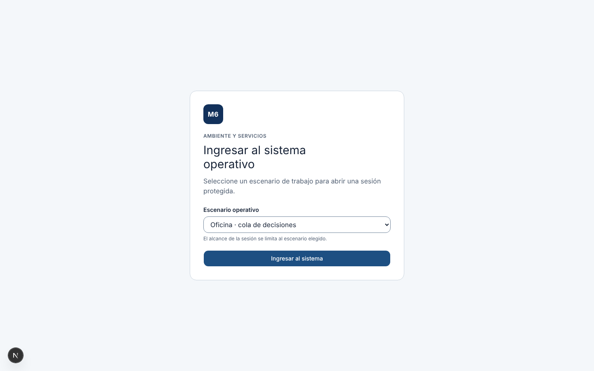

---

## 3. Requisitos y acceso

*Tipo Diátaxis: Referencia.*

### Qué necesita

- Un navegador actualizado (Chrome, Edge, Firefox o Safari) en computadora, tableta o celular.
- Conexión a internet. La aplicación funciona **en línea**: no guarda una cola de trabajo sin conexión. Ante un corte, los formularios de Campo conservan un borrador local (ver [apartado 7.4](#74-qué-pasa-si-se-corta-la-conexión)).
- La dirección de la aplicación: `https://frontend-m6-daps2-grupo4-modulo6.vercel.app`.

### Cómo ingresar

1. Abra la dirección de la aplicación. Si no tiene sesión, se muestra **Ingresar al sistema operativo**.
2. En **Escenario operativo**, elija el perfil con el que va a trabajar.
3. Pulse **Ingresar al sistema**.

> **Estado actual.** La autenticación real con el usuario y la contraseña del módulo de Identidad (M1) todavía no está habilitada, porque M1 no publicó cómo se verifica su token. Por eso hoy el ingreso se hace eligiendo un escenario. Si el sistema está en modo "M1 real", la pantalla informa *"La autenticación real de M1 no está disponible hasta publicar su contrato"* y no permite ingresar.

| Escenario | Perfil | Qué puede hacer |
|---|---|---|
| Oficina · cola de decisiones | Oficina, alcance completo | Todo lo descripto en el apartado 5 |
| Oficina · ingreso con alcance limitado | Oficina, solo consulta | Ver servicios, expedientes y mapa; no puede modificar nada |
| Campo · responsable de recorrido | Responsable de cuadrilla | Todo lo descripto en el apartado 6 |
| Campo · integrante de cuadrilla | Integrante de cuadrilla | Consultar el trabajo asignado, el mapa y los expedientes |

### Cómo salir

Pulse **Cerrar sesión**, arriba a la derecha. Si hay otras pestañas abiertas, también se cierran. Si el cierre falla, aparece *"No se pudo cerrar la sesión. Reintente."*

---

## 4. Primeros pasos (Tutorial)

*Tipo Diátaxis: Tutorial. Duración: unos 10 minutos. Necesita dos pestañas del navegador, una con el escenario de Oficina y otra con el de Campo responsable.*

**Objetivo:** programar un servicio de barrido, asignarle una cuadrilla, ejecutarlo en la calle y verlo cerrado.

### Parte 1 — Como Oficina: programar y asignar

1. Ingrese con **Oficina · cola de decisiones**. Se abre **Mi trabajo**, con las decisiones pendientes de la jornada.

   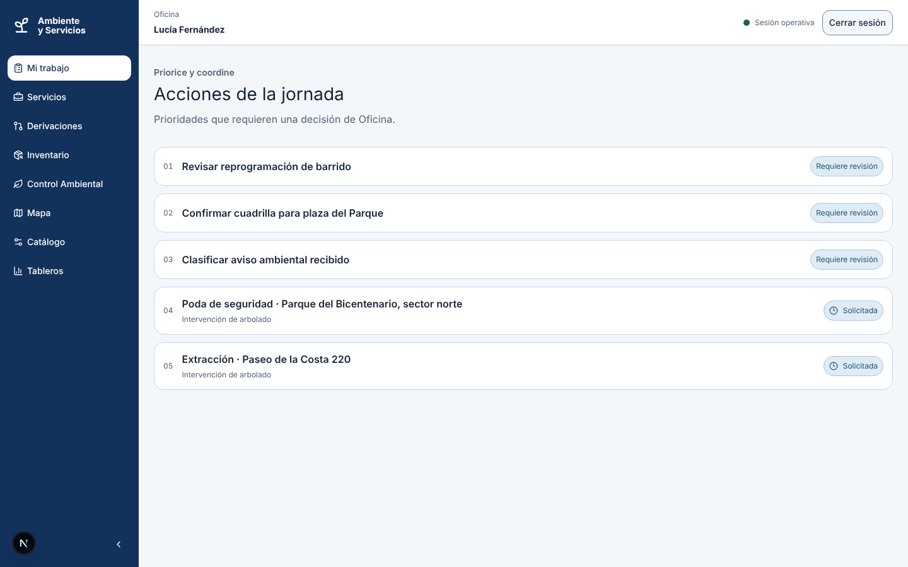

2. En el menú de la izquierda elija **Servicios**. Verá el mapa con los servicios y la tabla al lado.

   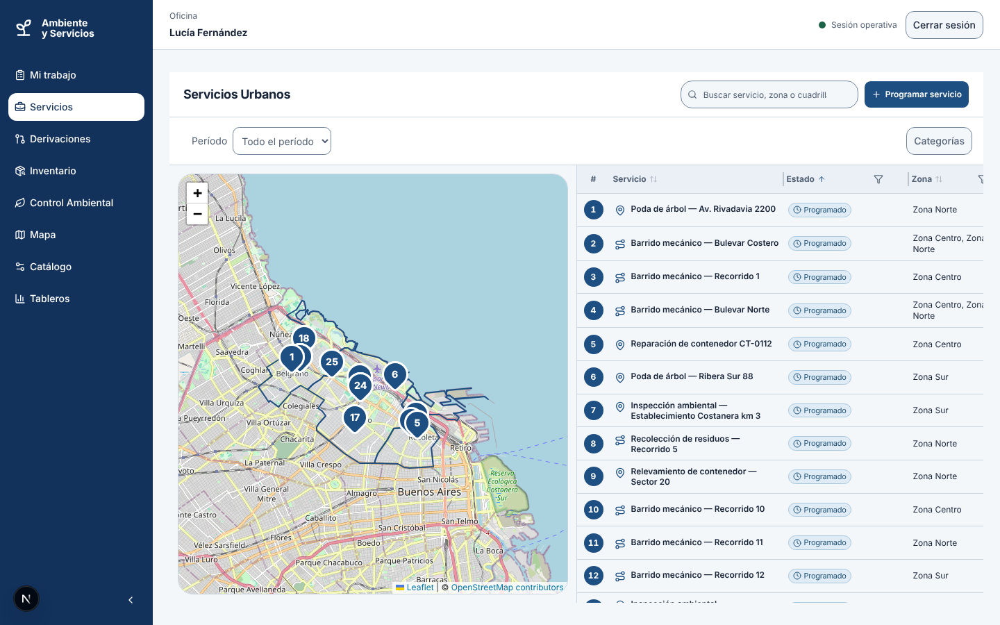

3. Pulse **Programar servicio**. En el formulario:
   - **Origen del servicio**: deje *Planificación*.
   - **Tipo de servicio**: elija *Barrido mecánico*.
   - **Recorrido asignado**: elija un recorrido. Las zonas se cargan solas.
   - **Fecha programada**: hoy o una fecha posterior.
   - **Desde** y **Hasta**: la ventana horaria.
4. Pulse **Programar servicio**. El servicio queda en estado **Programado**, sin cuadrilla ni vehículo.

   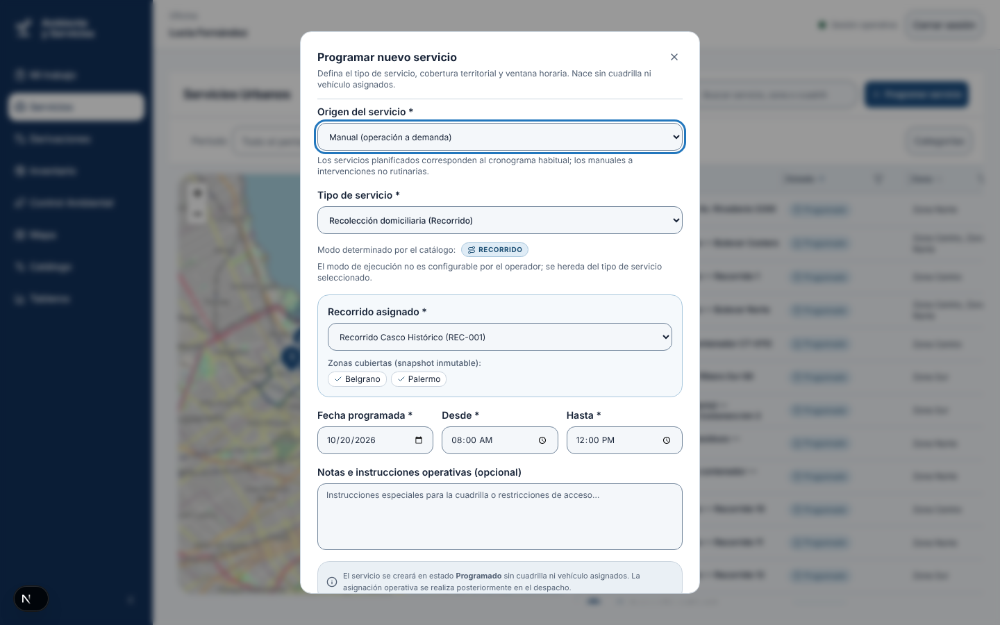

5. Abra el servicio y pulse **Asignar cuadrilla**. Elija la cuadrilla y el vehículo y confirme. Si el sistema avisa de una superposición horaria, lea el [apartado 7.2](#72-por-qué-el-sistema-avisa-pero-no-bloquea-una-superposición) antes de seguir.

   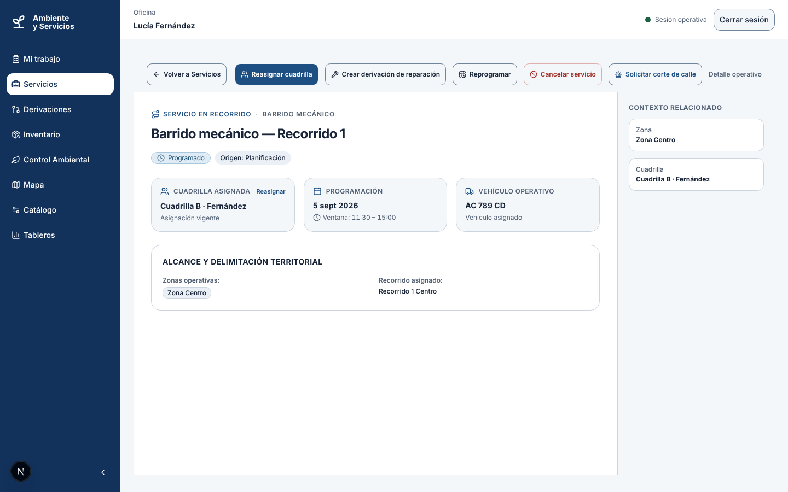

### Parte 2 — Como Campo: ejecutar

6. En la otra pestaña, ingrese con **Campo · responsable de recorrido**. En **Mi trabajo** aparecen los servicios asignados a su cuadrilla.

   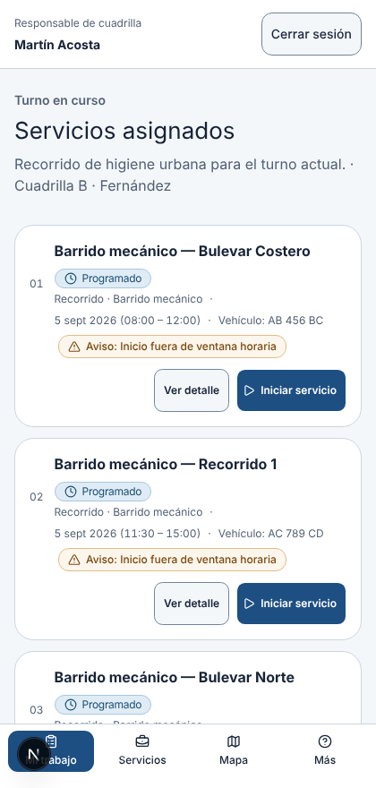

7. Abra el servicio (**Servicios** → tóquelo en la lista → **Ver detalle completo**) y pulse **Iniciar servicio**. El estado pasa a **En curso**.
8. Para cada zona, elija **Atendida**, **Parcial** o **No atendida** y pulse **Guardar resultado de zona**.
9. Cuando todas las zonas tengan resultado, aparece *"Todas las zonas registradas. Listo para finalizar."* Pulse **Completar servicio**.

### Resultado

El servicio queda **Completado** si todas las zonas fueron atendidas, o **Parcial** si alguna no lo fue. Ese resultado lo calcula el sistema; no se elige. En Oficina, vuelva a **Servicios** y compruebe el estado nuevo.

---

## 5. Tareas de Oficina

*Tipo Diátaxis: Guías prácticas. Cada guía parte de la pantalla correspondiente del menú.*

El menú lateral de Oficina tiene: **Mi trabajo, Servicios, Derivaciones, Inventario, Control Ambiental, Mapa, Catálogo, Tableros**. Cada usuario ve solo las entradas que su perfil permite. **Inventario** todavía no tiene contenido: muestra el aviso *"Este destino estará disponible como flujo operativo en una próxima entrega"*. El inventario se consulta y se edita desde **Catálogo**. En pantallas angostas, el menú pasa a una barra inferior con **Mi trabajo, Servicios, Mapa** y **Más**.

### 5.1 Buscar y filtrar servicios

1. Entre a **Servicios**.
2. Escriba en **Buscar servicio, zona o cuadrilla**, o use **Período**, **Categorías** y los filtros de cada columna.
3. Pulse **Limpiar todos los filtros aplicados** para volver a la lista completa.

El mapa y la tabla muestran lo mismo: tocar un número del mapa selecciona la fila, y al revés.

### 5.2 Programar un servicio

Ver el [Tutorial](#4-primeros-pasos-tutorial), paso 3. Lo que cambia según el **Origen del servicio**:

| Origen | Cuándo usarlo | Dato extra que pide |
|---|---|---|
| Planificación | Trabajo recurrente (la recolección de todos los martes) | Ninguno |
| Registro manual | Trabajo que surge sin reclamo ni inspección | Ninguno |
| Denuncia ciudadana | El servicio nace de un reclamo de M2 | **UUID del ticket de M2** |
| Inspección ambiental | Seguimiento de un hallazgo | Identificador (UUID) de la inspección |
| Alerta meteorológica | Respuesta a una alerta | Identificador de la alerta |

- Si el tipo de servicio es **Recorrido**, elija el recorrido: las zonas son las del recorrido.
- Si es **Punto**, elija el **Tipo de objetivo** (contenedor, árbol, espacio verde o punto verde) y el bien del inventario. Si no hay un bien, indique la **Zona operativa** y la **Dirección o referencia**.
- El ticket de M2 se pega como **UUID técnico**. El código corto `TK-…` no sirve: es solo una referencia para leer.

### 5.3 Asignar o reasignar cuadrilla y vehículo

1. Abra el servicio. Si está **Programado** o **A reprogramar**, aparece **Asignar cuadrilla** (o **Reasignar cuadrilla**).
2. Elija la **Cuadrilla asignada** y, si el tipo de servicio lo exige, el **Vehículo operativo**.
3. Si aparece **Aviso de superposición horaria**, escriba la **Justificación del solapamiento** (entre 10 y 500 caracteres). Queda registrada con su nombre y la fecha.
4. Pulse **Confirmar asignación**.

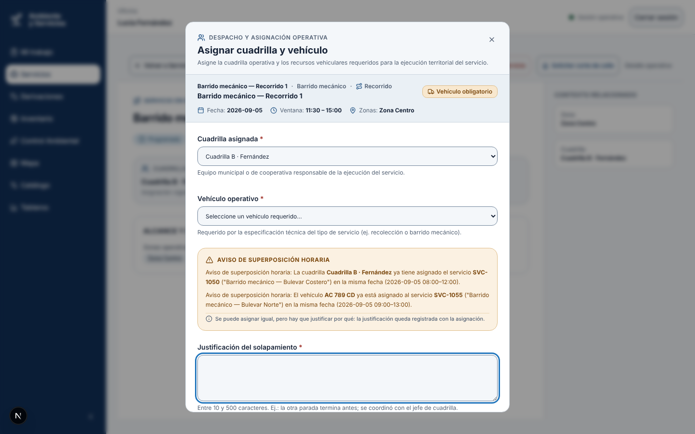

### 5.4 Reprogramar un servicio

La reprogramación tiene dos pasos, para que nunca quede una fecha inventada.

1. En un servicio **Programado**, pulse **Reprogramar** y escriba el **Motivo** (obligatorio). El servicio pasa a **A reprogramar**.
2. Cuando conozca la nueva fecha, abra el servicio y pulse **Confirmar nueva fecha**. Indique fecha y ventana horaria y confirme. Vuelve a **Programado**.

Un servicio puede quedar en **A reprogramar** sin que usted lo haya pedido: pasa cuando M7 rechaza un corte de calle o cuando entra una alerta meteorológica.

### 5.5 Cancelar un servicio

1. Abra el servicio. **Cancelar servicio** está disponible si está **Programado**, **A reprogramar** o **Suspendido**.
2. Escriba el **Motivo** (obligatorio) y confirme.

> **Atención.** Cancelar no se puede deshacer. Un servicio **En curso** no se cancela: la cuadrilla debe suspenderlo o completarlo primero. Si un servicio quedó **A reprogramar** porque M7 rechazó el corte por un plazo largo (por ejemplo, una obra por dos meses), cancelar es la decisión correcta y se hace directo.

### 5.6 Pedir un corte de calle o una reparación a otro módulo

Desde el detalle de un servicio:

- **Solicitar corte de calle** (a M7): disponible en servicios **Programado** o **A reprogramar**. Indique los tramos afectados con **Agregar tramo afectado**. Con el corte pendiente, **el servicio no puede iniciarse**; con el corte aprobado, sí.
- **Crear derivación de reparación** (a M3): para un daño de infraestructura que se detectó durante el servicio.

Las respuestas de M3 y M7 se siguen en **Derivaciones**. Allí se registran a mano (**Registrar aprobación de M7**, **Registrar rechazo de M7**, **Registrar finalización de M7**, **Registrar inicio de reparación**, **Registrar cierre de reparación**) solo cuando la respuesta no llegó sola. Las **Alertas de conciliación** señalan derivaciones que esperan una respuesta pasada de plazo, o respuestas que no se pudieron relacionar con certeza.

### 5.7 Administrar los catálogos

Entre a **Catálogo**. Cada tarjeta abre un listado con su alta, edición y baja:

| Catálogo | Contiene |
|---|---|
| Tipos de servicio | Categoría, modo (recorrido o punto) y si exige vehículo |
| Zonas operativas, Recorridos | Zonas que agrupan barrios; recorridos con paradas ordenadas |
| Frecuencias de servicio | Reglas por día, turno y vigencia |
| Cuadrillas, Vehículos | Equipos, sus integrantes y recursos móviles |
| Contenedores, Puntos verdes, Espacios verdes, Arbolado | Inventario urbano |
| Sitios de disposición | Rellenos, plantas y estaciones de transferencia |

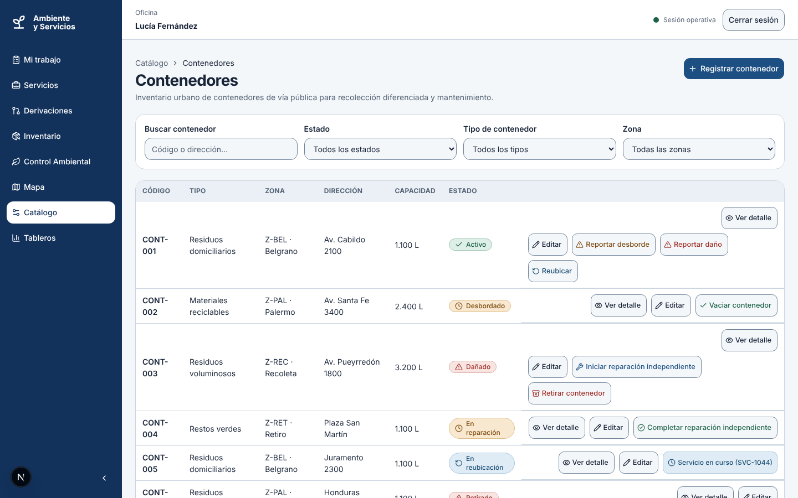

Reglas que conviene saber:

- La **baja es lógica**: el registro queda inactivo y se conserva su historia. Antes de desactivar una zona o un recorrido con servicios cargados, el sistema avisa.
- El **código** de un contenedor, de un tipo de servicio y de un relevamiento de árbol **no se puede cambiar** después de crearlo.
- **Cerrar la vigencia** de una frecuencia no modifica los servicios que ya se generaron con ella.

### 5.8 Gestionar contenedores

En **Catálogo → Contenedores**, desde la fila del contenedor. Para un daño elija el **tipo** (estructura, quemado, tapa rota, ruedas rotas, vandalizado o faltante) y la **severidad**; ambos son obligatorios.

| Situación | Acción | Resultado |
|---|---|---|
| Desbordado | **Reportar desborde**, luego **Vaciar contenedor** → **Confirmar vaciado** | Vuelve a **Activo** |
| Roto | **Reportar daño** (tipo y severidad) | Pasa a **Dañado** |
| Dañado | **Iniciar reparación** → **Confirmar reparación completa** | Pasa por **En reparación** y vuelve a **Activo** |
| Dañado sin arreglo | **Confirmar retiro** | **Retirado** |
| Hay que moverlo | **Iniciar reubicación** → **Confirmar ubicación** (nueva dirección) | Vuelve a **Activo** |

El vaciado y la reubicación se ejecutan como un servicio puntual; cerrar ese servicio es lo que cambia el estado del contenedor.

### 5.9 Intervenciones sobre arbolado

En **Catálogo → Arbolado** y **Intervenciones de arbolado**:

1. **Solicitar intervención** sobre uno o más árboles: poda de formación, poda de seguridad, extracción, plantación o tratamiento.
2. Una **extracción** exige justificación y pasa por **Enviar a autorización**; el resto se autoriza directamente.
3. Quien tiene la capacidad de autorizar elige **Autorizar intervención** o **Rechazar intervención**. Si se rechaza una extracción, puede crear una solicitud nueva con los mismos datos.
4. Una intervención autorizada se programa con **Programar servicio para la intervención**: se crea un servicio puntual vinculado.

Para registrar un **relevamiento** de un árbol, abra el árbol en **Catálogo → Arbolado** y pulse **Registrar relevamiento**. Cada relevamiento queda en el historial del ejemplar; no pisa el anterior.

### 5.10 Tramitar una denuncia ambiental

Entre a **Control Ambiental**. La cola muestra los expedientes; filtre por **Estado**, **Tipo de hallazgo** y **Prioridad**, o busque por ID, dirección o ticket.

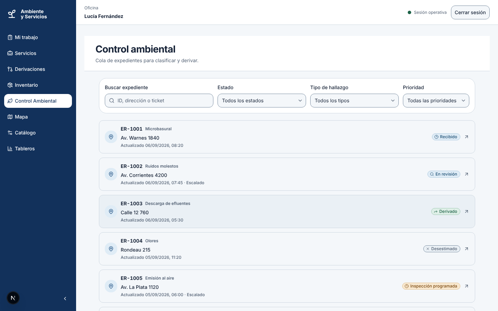

Abra un expediente. El recuadro **Siguiente decisión de Oficina** ofrece solo lo que el estado permite:

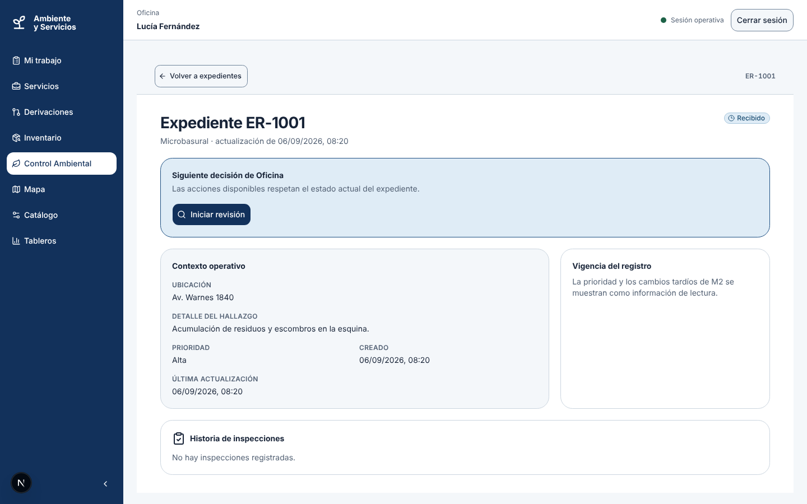

| Estado del expediente | Qué puede hacer Oficina |
|---|---|
| Recibido | **Iniciar revisión** |
| En revisión | **Programar inspección**, **Derivar expediente** (no es de nuestra competencia) o **Desestimar expediente** |
| Inspección programada | **Reprogramar inspección** |
| Inspeccionado, con resultado inconcluso | **Programar reinspección** (nueva inspección y nuevo servicio; la anterior queda en la historia) |
| Infracción constatada | **Emitir aviso de infracción** (acta) |
| Derivado, Desestimado, Sin infracción, Sancionado | **Cerrar expediente** |

Para **Programar inspección** hay que elegir una **zona operativa**, la fecha y la cuadrilla. El tipo de servicio es siempre puntual y se determina solo.

**El acta.** Es un documento formal e **inmutable**: si hay un error, se emite otra, no se corrige la anterior. Requiere identificar el **establecimiento**. Si no se lo identifica, se usa **Registrar aviso no derivado**: el acta queda registrada y el expediente se cierra de nuestro lado, pero no se envía a M4 y no implica una sanción. La acción sugerida (advertencia, intimación, multa o clausura) **no es vinculante**: decide M4.

**Después del acta.** Cuando M4 resuelve, el expediente pasa a **Sancionado**. M4 no avisa cuando decide que no corresponde sanción; por eso, si pasa el plazo sin respuesta, el expediente se **cierra solo**. Un expediente **Sancionado** no se reabre.

Si el vecino rechaza la solución en M2, el expediente vuelve a **En revisión**.

### 5.11 Consultar el mapa

**Mapa** muestra las zonas operativas, la cobertura por zona, los puntos verdes, los espacios verdes y los árboles con riesgo crítico. Use **Capas visibles** para activar o desactivar capas y **Actualizar datos** para recargar. Toda la información del mapa también está disponible en una lista, para quien no pueda usarlo.

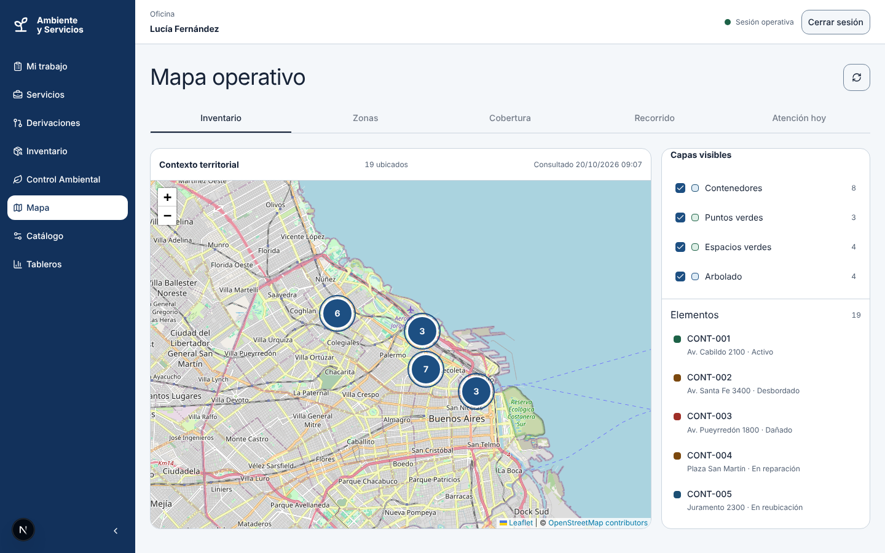

### 5.12 Leer los indicadores

**Tableros** reúne cuatro familias. Elija **Desde**, **Hasta**, **Familia**, **Zona operativa** y **Tipo de servicio**, y pulse **Actualizar**.

| Familia | Qué mide |
|---|---|
| Cobertura | Objetivos atendidos sobre programados |
| Cumplimiento | Servicios en fecha, y ranking de zonas no atendidas con sus motivos |
| Incidencias | Contenedores desbordados y dañados, árboles por riesgo, tiempo medio de resolución de denuncias |
| Residuos | Kilos y metros cúbicos por tipo y destino; porcentaje desviado del relleno |

Cada gráfico puede verse como **Barras** o como **Tabla**.

> **Unidad de análisis: servicio + zona.** Un recorrido que pasa por cuatro zonas y atiende tres cuenta como tres objetivos atendidos y uno pendiente, no como un servicio cumplido. Los servicios cancelados no cuentan como incumplimiento.

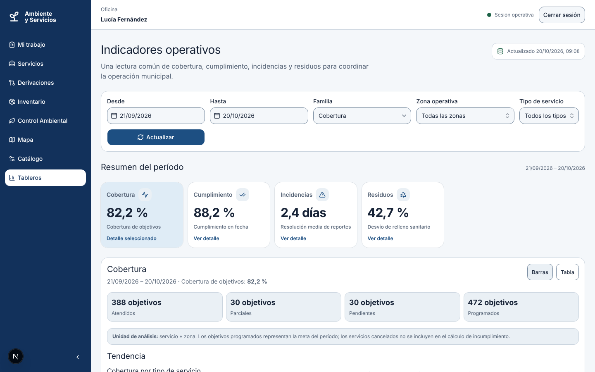

---

## 6. Tareas de Campo

*Tipo Diátaxis: Guías prácticas. Pensadas para usar en la calle, con una mano.*

El menú de Campo tiene **Mi trabajo, Servicios, Derivaciones, Control Ambiental** y **Mapa**. En el celular se ven **Mi trabajo, Servicios, Mapa** y **Más** (el resto está dentro de **Más**).

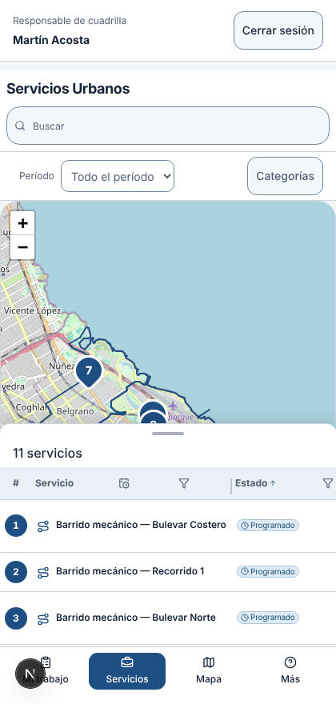

### 6.1 Ver mi trabajo del día

1. En **Mi trabajo** figuran los servicios asignados a su cuadrilla.
2. En **Servicios**, tóquelos para ver cuadrilla, fecha, horario, vehículo, notas operativas e historial de cambios. **Ver detalle completo** abre la pantalla completa.

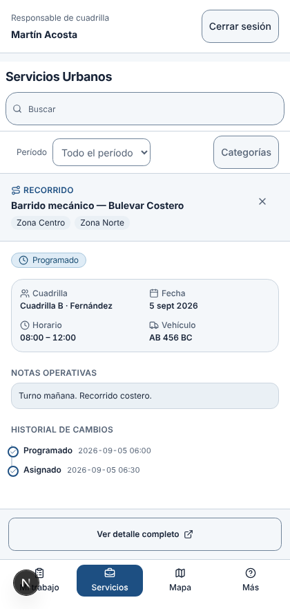

### 6.2 Iniciar un servicio *(solo responsable de cuadrilla)*

1. Abra el servicio y pulse **Iniciar servicio**.
2. Si lo inicia **fuera de la ventana horaria**, el sistema lo permite pero deja el aviso *"Inicio fuera de ventana horaria"*.
3. No se puede iniciar sin cuadrilla asignada, ni sin vehículo si el tipo de servicio lo exige, ni con un corte de calle pendiente.

### 6.3 Registrar el resultado de cada zona

1. Con el servicio **En curso**, elija una zona. En un recorrido se pueden cargar en cualquier orden; un servicio puntual tiene una sola zona.
2. Marque **Atendida**, **Parcial** o **No atendida**.
3. Si es **Parcial** o **No atendida**:
   - Elija el **Motivo de la excepción**: desperfecto vehicular, cuadrilla no disponible, acceso bloqueado, corte de calle u obra, condición meteorológica, exceso de volumen, incidente de seguridad u otro motivo.
   - **Adjunte al menos una evidencia** (fotografía o documento).
4. Agregue observaciones si hace falta y pulse **Guardar resultado de zona**.

**Evidencia.** Pulse **Seleccionar archivo(s)**. Se aceptan JPEG, PNG, WebP y PDF, hasta 4 MB por archivo. Los archivos se suben de a uno. Si uno falla, aparece **Reintentar carga**; use **Quitar** para sacarlo de la lista. Las fotos pierden sus metadatos (ubicación y datos de la cámara) al subirse; los PDF se guardan tal cual.

### 6.4 Suspender, reanudar y completar

| Acción | Cuándo | Qué se pide |
|---|---|---|
| **Suspender servicio** | Con el servicio **En curso** y un impedimento | Motivo |
| **Reanudar servicio** | Con el servicio **Suspendido** y la causa resuelta | Nada |
| **Completar servicio** | Cuando todas las zonas tienen resultado | Nada: el sistema decide si queda **Completado** o **Parcial** |

Un servicio suspendido que no se puede retomar lo cancela Oficina; Campo no cancela.

### 6.5 Completar una inspección ambiental *(solo responsable de cuadrilla)*

1. Abra el servicio de inspección y pulse **Iniciar servicio**. Hasta entonces el formulario está bloqueado: *"El servicio todavía no está en curso"*.
2. Indique **Fecha y hora de inspección** (se admite una diferencia de 5 minutos por el reloj del dispositivo).
3. Marque cada control del **Checklist asignado**. Mientras falten, aparece *"Faltan controles por completar."*
4. Elija el **Resultado de la inspección**: sin infracción, infracción constatada o inconcluso.
   - Con **infracción**, complete **Tipo de infracción**, gravedad y **Acción sugerida**.
   - Con **inconcluso**, explique qué impidió confirmar el resultado.
5. Agregue la **Conclusión** (opcional) y la **Evidencia de la inspección**.
6. Pulse **Completar inspección**.

La decisión final sobre el acta es de Oficina; este formulario no la determina. Si el servicio sigue abierto después de registrar la inspección, el aviso *"El servicio sigue abierto"* recuerda que falta registrar el resultado de la zona y completarlo.

### 6.6 Ver los expedientes ambientales de mi contexto

En **Control Ambiental** figuran los hallazgos asignados a su contexto operativo. Allí consulta el detalle y la historia de inspecciones; la ejecución de la inspección se hace desde el servicio (ver 6.5).

> **Reportar contenedores y registrar relevamientos de árboles.** El sistema define estas acciones también para Campo, pero hoy su menú no incluye **Catálogo**, que es donde están los botones. Mientras tanto, las hace Oficina (apartados 5.8 y 5.9). Ver [Limitaciones conocidas](#10-limitaciones-conocidas).

---

## 7. Cómo funciona (Explicación)

*Tipo Diátaxis: Explicación. Para entender por qué la aplicación se comporta como se comporta.*

### 7.1 Servicios por recorrido y servicios puntuales

Todo trabajo programado es un **Servicio**. Hay dos modos:

- **Recorrido**: una secuencia ordenada de zonas (por ejemplo, recolección domiciliaria en Zona Norte). Tiene un resultado por cada zona.
- **Punto**: un bien del inventario o una dirección (vaciar el contenedor CT-0442, podar un árbol). Tiene un único resultado.

Las zonas se **copian** al programar el servicio. Si después se edita el recorrido, lo ya programado no cambia.

### 7.2 Por qué el sistema avisa, pero no bloquea, una superposición

Si la cuadrilla o el vehículo ya tienen otro servicio ese día en una franja que se pisa, el sistema **avisa** y pide una justificación en lugar de impedir la asignación. La razón es práctica: a veces la misma cuadrilla hace dos cosas seguidas y quien planifica lo sabe. La justificación queda registrada para auditar la decisión. Un servicio sin ventana horaria se considera ocupado **todo el día**.

### 7.3 Por qué hay tantos estados

Cada estado dice qué se puede hacer a continuación, y solo eso se ofrece en pantalla. Por eso un botón puede no aparecer: no es un error, es que ese paso no corresponde en el estado actual. Los estados del servicio, del expediente, del contenedor y de la intervención están en el [apartado 8](#8-referencia-de-estados-y-valores).

"Demorado" **no es un estado** de un servicio: un servicio demorado sigue **Programado** o **En curso**.

### 7.4 Qué pasa si se corta la conexión

La aplicación no sincroniza sola en segundo plano. Cuando una acción de Campo falla por falta de conexión:

1. El formulario queda guardado como **borrador local** en ese dispositivo, con el aviso *"Borrador local pendiente de envío (sin conexión)"*.
2. Cuando vuelva la señal, pulse **Reintentar envío**. Nada se envía sin que usted lo confirme.
3. Si mientras tanto Oficina reasignó, canceló o reprogramó el servicio, aparece **Conflicto de sincronización** con una comparación entre su borrador y la **versión actual del servidor**. El borrador **no se aplica solo**: usted decide si lo conserva o lo descarta (**Descartar borrador**).

El borrador es personal: pertenece al usuario que lo escribió y no lo ve quien ingrese después en el mismo dispositivo.

### 7.5 Con quién se conecta este módulo

La aplicación trabaja con otros módulos de la Municipalidad, y eso se nota en pantalla:

| Módulo | Qué intercambia con este |
|---|---|
| **M2 — Atención al ciudadano** | Nos envía las denuncias; recibe el avance de la inspección para mostrárselo al vecino. El vecino ve el estado, no lo que escribió el inspector |
| **M3 — Obras y reparaciones** | Recibe las derivaciones de reparación (daño de infraestructura) |
| **M4 — Comercio y habilitaciones** | Recibe las actas; devuelve la multa o la clausura |
| **M7 — Tránsito y cortes** | Recibe los servicios programados y los pedidos de corte de calle; responde si aprueba o rechaza |
| **M1 — Identidad** | Emite el inicio de sesión (todavía no habilitado) |

Estas comunicaciones son asincrónicas: una respuesta puede tardar. Mientras tanto, la derivación figura como pendiente.

### 7.6 Privacidad

Los datos de quien denuncia, los hallazgos de la inspección y el detalle de las actas son los más sensibles. Quedan dentro de este módulo y **no se muestran al vecino**. Las fotos se limpian de metadatos al subirse.

---

## 8. Referencia de estados y valores

*Tipo Diátaxis: Referencia.*

### 8.1 Estados del servicio

| Estado en pantalla | Significado | Qué puede hacer cada rol |
|---|---|---|
| **Programado** | Tiene fecha; puede tener o no cuadrilla | Oficina: asignar, reprogramar, cancelar. Responsable: iniciar |
| **A reprogramar** | Hay que moverlo y todavía no se sabe adónde | Oficina: confirmar nueva fecha, asignar, cancelar |
| **En curso** | La cuadrilla está trabajando | Responsable: registrar zonas, suspender, completar |
| **Suspendido** | Detenido por un impedimento | Responsable: reanudar. Oficina: cancelar |
| **Completado** | Todas las zonas atendidas. Final | — |
| **Parcial** | Alguna zona no se atendió o se atendió a medias. Final | — |
| **Cancelado** | Ya no se hace. Final | — |

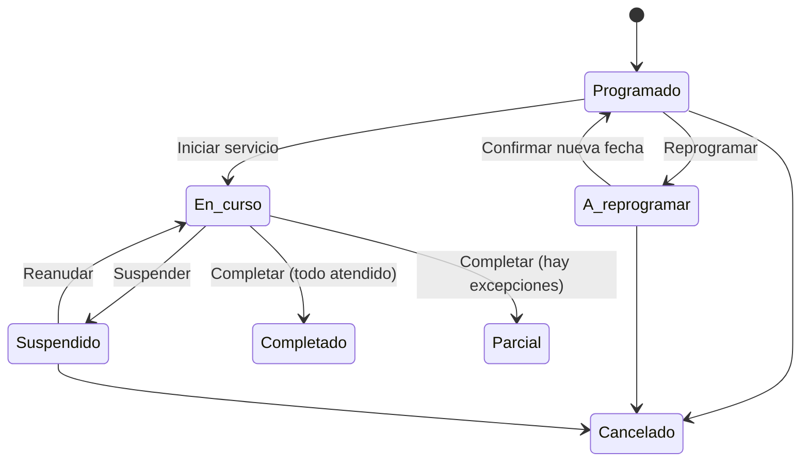

### 8.2 Estados del expediente ambiental

| Estado | Significado |
|---|---|
| Recibido | Llegó la denuncia, sin revisar |
| En revisión | Oficina la está clasificando |
| Derivado | No es de nuestra competencia; se devolvió a M2 |
| Desestimado | Se descartó sin inspección |
| Inspección programada | Hay inspección y servicio agendados |
| Inspeccionado | Se realizó la inspección |
| Sin infracción | La inspección no encontró infracción |
| Infracción constatada | La inspección encontró una infracción; falta el acta |
| Acta emitida | Se emitió el acta y se envió a M4 |
| Sancionado | M4 resolvió |
| Cerrado | Terminó. Puede reabrirse si el vecino rechaza la solución, salvo si fue Sancionado |

### 8.3 Estados del contenedor

**Activo, Desbordado, Dañado, En reparación, En reubicación, Retirado.** Ver el flujo en el [apartado 5.8](#58-gestionar-contenedores).

### 8.4 Estados de una intervención sobre árboles

**Solicitada → Pendiente de autorización** (solo extracción) **→ Autorizada** o **Rechazada**. Una autorizada se programa asociándola a un servicio puntual.

### 8.5 Resultado de una zona

| Resultado | Pide motivo | Pide evidencia |
|---|---|---|
| Atendida | No | Opcional |
| Parcial | Sí | Sí |
| No atendida | Sí | Sí |

### 8.6 Qué ve cada perfil

| Función | Oficina completa | Oficina limitada | Campo responsable | Campo integrante |
|---|---|---|---|---|
| Ver servicios y mapa | ✔ | ✔ | ✔ | ✔ |
| Programar, asignar, reprogramar, cancelar | ✔ | — | — | — |
| Iniciar, suspender, completar servicios | — | — | ✔ | — |
| Administrar catálogos | ✔ | — | — | — |
| Reportar contenedores / relevamiento de árboles | ✔ | — | Definido, sin acceso desde el menú | Definido, sin acceso desde el menú |
| Clasificar y cerrar denuncias, emitir actas | ✔ | — | — | — |
| Completar inspecciones | — | — | ✔ | — |
| Ver expedientes ambientales | ✔ | ✔ | ✔ | ✔ |
| Ver indicadores | ✔ | — | — | — |

> Estas restricciones se aplican en la pantalla. Hoy el servidor autentica cada pedido pero **todavía no restringe por rol**: lo que no aparece en su menú no debe intentar hacerse por otros medios.

---

## 9. Mensajes de error y qué hacer

*Tipo Diátaxis: Referencia.*

| Mensaje | Qué pasó | Qué hacer |
|---|---|---|
| *Inicie sesión para continuar* | La sesión venció o no existe | Pulse **Volver a iniciar sesión** |
| *No se pudo cargar el escenario* | Falló la carga inicial | Pulse **Reintentar carga**; si persiste, avise a soporte |
| *La fecha programada debe ser hoy o una fecha posterior en Argentina* | La fecha es pasada | Elija una fecha de hoy en adelante |
| *Debe indicar el motivo de la cancelación / reprogramación* | Falta el motivo | Escríbalo; es obligatorio |
| *Hay un solapamiento: justifique la asignación en al menos 10 caracteres* | La cuadrilla o el vehículo ya están ocupados | Escriba una justificación de 10 a 500 caracteres o elija otra cuadrilla |
| *El ticketId debe ser un UUID válido* | Pegó el código `TK-…` | Pegue el UUID técnico del reclamo, no el código corto |
| *Debe adjuntar al menos una evidencia para este resultado* | Resultado parcial o no atendido sin archivo | Adjunte una foto o un documento |
| *El motivo es obligatorio para resultados parciales o no atendidos* | Falta el motivo de excepción | Elija uno de la lista |
| *No se pudo subir el archivo* | Falló la subida | Pulse **Reintentar carga**. Verifique que sea JPEG, PNG, WebP o PDF de hasta 4 MB |
| *No se pudo conectar con el servidor. El resultado quedó guardado como borrador local* | Sin conexión | No pierde nada. Reintente cuando haya señal (ver 7.4) |
| *Conflicto de sincronización* | El servicio cambió mientras usted trabajaba sin conexión | Compare las versiones y decida si conserva o descarta su borrador |
| *Faltan controles por completar* | Quedan puntos del checklist sin marcar | Marque cada control realizado |
| *No se pudo actualizar el expediente. Recargue la pantalla* | El expediente cambió de estado | Recargue y revise qué acciones ofrece ahora |
| *Debe seleccionar una zona operativa para programar la inspección* | Falta la zona | Elija la zona |
| *No se pudieron cargar las derivaciones de este Servicio* | Falló la consulta a derivaciones | Cierre y vuelva a abrir el servicio |

Un botón que falta casi siempre significa que ese paso no corresponde al estado actual o a su perfil (ver 7.3 y 8.6). No hay nada que reparar.

---

## 10. Limitaciones conocidas

*Tipo Diátaxis: Referencia. Estado al 20/10/2026.*

- **Ingreso:** hoy se entra eligiendo un escenario; el ingreso real con M1 está a la espera de que M1 publique su contrato.
- **Catálogo de barrios:** la lista de barrios usada para armar zonas es provisoria; la fuente definitiva es el catálogo de M9, que todavía no está conectado.
- **Establecimientos:** la búsqueda del establecimiento al emitir un acta usa una lista local hasta que M4 publique la suya.
- **Inventario:** la entrada del menú existe pero todavía no tiene contenido; use **Catálogo**.
- **Campo y el catálogo:** reportar desbordes y daños de contenedores y registrar relevamientos de árboles están permitidos para Campo, pero el menú de Campo no incluye **Catálogo**; hoy lo hace Oficina.
- **Aviso de demora:** el servidor soporta avisos de demora, pero la pantalla todavía no los ofrece.
- **Exportación:** no hay exportación de registros a archivo; los indicadores son solo de lectura en pantalla.
- **PDF:** los PDF adjuntos no se limpian de metadatos ni se analizan en busca de virus.
- **Historial de consultas:** no se registra quién consultó cada denuncia.

---

## 11. Preguntas frecuentes

**¿Por qué no veo el botón "Iniciar servicio"?**
Solo el responsable de la cuadrilla asignada puede iniciarlo, y solo si el servicio está **Programado**, tiene cuadrilla asignada (y vehículo, si el tipo lo exige) y no tiene un corte de calle pendiente.

**¿Puedo asignar una cuadrilla que ya está ocupada ese día?**
Sí, con una justificación. El sistema avisa pero no lo impide.

**¿Puedo corregir un acta ya emitida?**
No. Es un acto formal y no se edita. Se emite una nueva.

**¿Qué hago si no tengo señal en la calle?**
Complete el formulario igual. Queda como borrador en su dispositivo; cuando vuelva la conexión, pulse **Reintentar envío**.

**¿Por qué un servicio que atendí casi todo figura como "Parcial"?**
Porque alguna zona quedó **Parcial** o **No atendida**. El sistema lo calcula; no se elige.

**¿Cómo cancelo un servicio que ya empezó?**
Primero se suspende (Campo). Luego Oficina lo cancela.

**¿Por qué un servicio apareció como "A reprogramar" sin que nadie lo tocara?**
Lo pasa el sistema cuando M7 rechaza un corte de calle o entra una alerta meteorológica. Oficina decide si lo reprograma o lo cancela.

**¿Cuánto tarda en actualizarse lo que pidió a M3 o M7?**
Depende de ese módulo. Mientras no respondan, la derivación figura como pendiente; si pasa el plazo, aparece una alerta de conciliación.

**¿Dónde veo cuántos servicios se cumplieron?**
En **Tableros**, familia **Cumplimiento**.

---

## 12. Glosario

| Término | Qué significa |
|---|---|
| **Servicio** | Unidad de trabajo programable: tipo, fecha, cuadrilla y estado. Puede ser por recorrido o puntual |
| **Recorrido / Punto** | Los dos modos de un servicio: varias zonas en orden, o un solo bien o dirección |
| **Zona operativa** | Agrupación de barrios para armar recorridos y asignar cuadrillas. Es propia de este módulo |
| **Cuadrilla** | Equipo municipal o de cooperativa que ejecuta servicios |
| **Asignación** | Atar una cuadrilla y un vehículo a un servicio ya programado. Es una decisión distinta de programar |
| **Resultado de zona** | Cómo quedó una zona: atendida, parcial o no atendida |
| **Evidencia** | Foto o documento que respalda un resultado, una inspección o un reporte |
| **Borrador local** | Lo que se cargó sin conexión y espera un reenvío manual |
| **Expediente ambiental** | Caso que nace de una denuncia (o de una detección propia) y avanza hasta su cierre |
| **Acta** | Documento formal e inmutable que emite Oficina al constatar una infracción |
| **Aviso no derivado** | Acta registrada sin enviarla a M4 por no haber identificado el establecimiento |
| **Derivación** | Pedido que este módulo le hace a otro: reparación (M3) o corte de calle (M7) |
| **Conciliación** | Revisión manual de una derivación cuya respuesta falta o llegó desordenada |

---

## 13. Soporte

- **Ayuda en línea:** este manual.
- **Estado del sistema:** `https://frontend-m6-daps2-grupo4-modulo6.vercel.app/api/health` debe responder `"status":"ok"`.
- **Consultas y fallas:** abra un Issue en el repositorio del equipo ([Frontend](https://github.com/hllous/Frontend-M6-DAPS2) o [Backend](https://github.com/hllous/Backend-M6-DAPS2)), con una captura y los pasos para reproducirlo.
- **Servicio de consulta pública (sin ingreso):** el backend ofrece consultas abiertas para el ciudadano —seguimiento de una denuncia, cuándo pasa el servicio y dónde están los puntos verdes— que consume el portal de M2.

---

## 14. Índice por rol y clasificación Diátaxis

*Entregable de la Parte B, punto 6.*

| # | Sección | Rol | Tipo Diátaxis |
|---|---|---|---|
| 2 | Qué es esta aplicación y para quién | Todos | Explicación |
| 3 | Requisitos y acceso | Todos | Referencia |
| 4 | Primeros pasos | Todos | **Tutorial** |
| 5.1 | Buscar y filtrar servicios | Oficina | Guía práctica |
| 5.2 | Programar un servicio | Oficina | Guía práctica |
| 5.3 | Asignar cuadrilla y vehículo | Oficina | Guía práctica |
| 5.4 | Reprogramar un servicio | Oficina | Guía práctica |
| 5.5 | Cancelar un servicio | Oficina | Guía práctica |
| 5.6 | Corte de calle y reparación | Oficina | Guía práctica |
| 5.7 | Administrar catálogos | Oficina | Guía práctica |
| 5.8 | Gestionar contenedores | Oficina | Guía práctica |
| 5.9 | Intervenciones sobre arbolado | Oficina | Guía práctica |
| 5.10 | Tramitar una denuncia ambiental | Oficina | Guía práctica |
| 5.11 | Consultar el mapa | Oficina, Campo | Guía práctica |
| 5.12 | Leer los indicadores | Oficina | Guía práctica |
| 6.1 | Ver mi trabajo del día | Campo | Guía práctica |
| 6.2 | Iniciar un servicio | Campo (responsable) | Guía práctica |
| 6.3 | Registrar el resultado de cada zona | Campo (responsable) | Guía práctica |
| 6.4 | Suspender, reanudar y completar | Campo (responsable) | Guía práctica |
| 6.5 | Completar una inspección ambiental | Campo (responsable) | Guía práctica |
| 6.6 | Ver los expedientes ambientales de mi contexto | Campo | Guía práctica |
| 7 | Cómo funciona | Todos | Explicación |
| 8 | Estados y valores | Todos | Referencia |
| 9 | Mensajes de error | Todos | Referencia |
| 10 | Limitaciones conocidas | Todos | Referencia |
| 11–12 | Preguntas frecuentes y glosario | Todos | Referencia |

---

## Apéndice — Trazabilidad con el BRD y la documentación funcional

Cada guía de este manual responde a un requisito de negocio. La numeración BR/HU/CP está en el esqueleto documental de la actividad; esta tabla fija el vínculo con la tarea del manual.

| Tarea del manual | Requisito de negocio que cubre | Componente del sistema |
|---|---|---|
| 5.2–5.5 Programar, asignar, reprogramar, cancelar | Planificar y asignar servicios urbanos con trazabilidad | Servicio (máquina de estados) |
| 6.2–6.4 Iniciar, registrar zona, completar | Registrar lo ejecutado y lo no atendido con su motivo | Servicio + Resultado de zona |
| 5.10 y 6.5 Denuncia, inspección y acta | Tramitar denuncias ambientales hasta el acta | Expediente + Inspección + Acta |
| 5.8 Contenedores | Mantener el inventario y su estado operativo | Contenedor (estados) |
| 5.12 Indicadores | Medir cobertura y cumplimiento | Indicadores (cobertura, cumplimiento, incidencias, residuos) |
